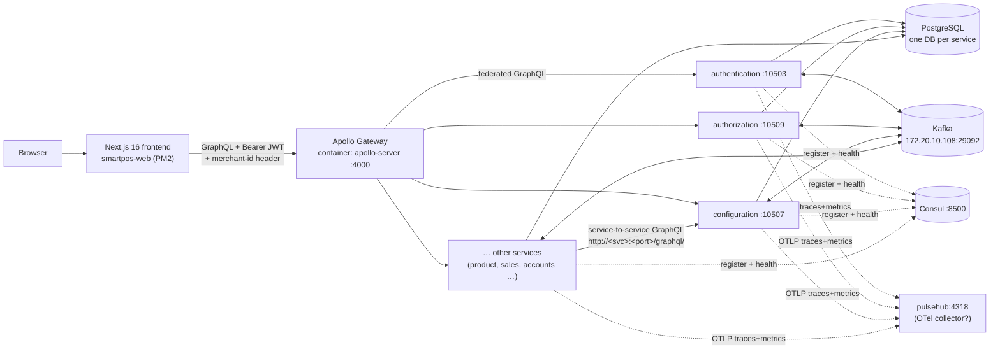
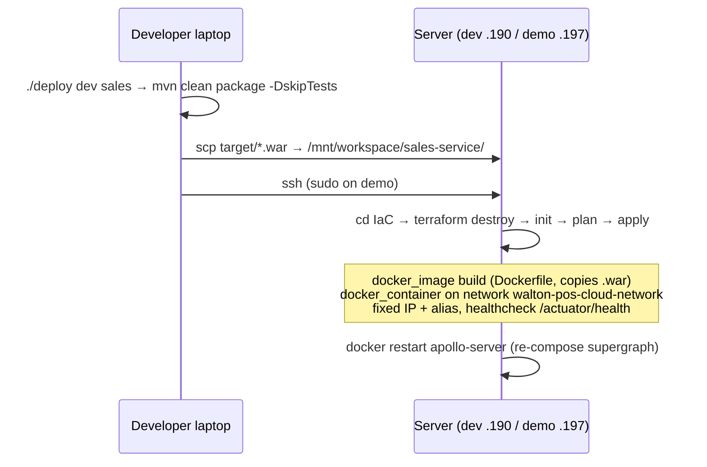
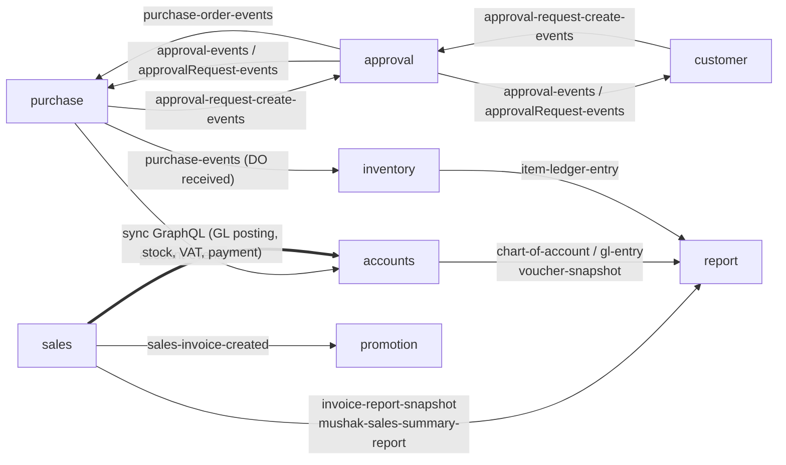

# 01 — Infrastructure & Runtime

> Status: **in progress** (code side done; server side pending — session 8). Last updated 2026-10-17.
> Source of truth: repo code/config. Things only visible on the servers are marked **[verify on server]**.

## ⚠ Corrections after reading the dev server (see `08-servers.md`)
- The front door is **Kong 3.9** (`/graphql` → `apollo-server:4000`), not the gateway directly.
- The running gateway is a **newer TypeScript Apollo gateway** that discovers subgraphs **through Consul** — so Consul *is* used (by the gateway), just not service-to-service. The `gateway-service/` folder locally is an old copy.
- `pulsehub` = OpenTelemetry Collector; with **Jaeger** (traces), **Prometheus** + **Grafana** (metrics). No Elasticsearch. **But the collector only prints traces to stdout — Jaeger gets nothing** (see 08).
- JWT: Kong and the gateway don't verify it; **4 services do** (accounts, authorization, configuration, purchase — see 02 §3); the rest don't.
- "unhealthy" containers = healthcheck gets 401/403 from Spring Security; Consul uses heartbeats so the gateway still sees them as healthy.
- Three more services run on the server but aren't in your folder: **compliance (10502), notification (10510), order (10515)**.

## 1. The big picture

Every backend service is the same shape: **Spring Boot 3.5 / Java 17 → `.war` → Docker container**, exposing **only GraphQL** at `/graphql/` (+ `/graphiql`, `/actuator/health`, `/actuator/prometheus`).

## 2. Port & container map

| Service | Port | `spring.application.name` | DB (prod profile `db-unipos`) | Docker IP (Terraform) |
|---|---|---|---|---|
| product | 10501 | product-service | product_db | see IaC |
| authentication | 10503 | authentication-service | auth | |
| customer | 10504 | customer-service | customer | |
| promotion | 10506 | promotion-service | promotion_db | |
| configuration | 10507 | configuration-service | configuration_db | |
| purchase ("order") | 10508 | purchase-service | purchase_db | |
| authorization | 10509 | authorization-service | authorization_db | |
| policy | 10511 | policy-service | policy_db | |
| accounts | 10512 | **account-service** (no "s") | accounts_db | |
| inventory | 10513 | inventory-service | inventory_db | |
| sales | 10514 | sales-service | sales_db | 172.20.0.23 |
| payment | 10516 | payment-service | payments_db | |
| vat | 10517 | vat-service | vat_db | 172.20.0.26 |
| report | 10518 | report-service | reports_db | |
| approval | 10519 | **approval_service** (underscore) | approval_db | |
| gateway (Node) | 4000 | apollo-server container | — | |

Ports 10502 (price) and 10510 (notification) are reserved in old gateway config but **those services don't exist in this folder**. Purchase is referred to as `order-service` in other services' config (`order.url=http://order-service:10508`).

## 3. Configuration & Spring profiles

Each service: `src/main/resources/config/`

| File | Purpose |
|---|---|
| `application.properties` | common: port, JPA, Consul, Actuator, Kafka group, OTel. Its own `spring.profiles.active/include` are **dev defaults** |
| `application-prod.properties` | running **inside Docker**: Consul host `consul`, Kafka `172.20.10.108:29092`, peer URLs by Docker hostname (`http://configuration-service:10507/graphql/`) |
| `application-local.properties` | running **on your laptop**: everything points to the dev server `192.168.20.190` |
| `application-db-unipos.properties` | DB = `192.168.20.196:5432/<svc>_db` (= **demo DB** per user) |
| `application-db-pos-dev.properties` | DB = `192.168.200.52:5432/<svc>_db` (= **dev DB** per user) |

- What actually runs on the server is decided by **Terraform env vars**, which override the file: `SPRING_PROFILES_ACTIVE=prod`, `SPRING_PROFILES_INCLUDE=db-unipos`.
- DB username/password are **Jasypt-encrypted** (`ENC(...)`); the decryption key must come from the environment/JVM **[verify on server — not visible in Terraform]**.
- **Schema management = `spring.jpa.hibernate.ddl-auto=update` in every service.** No Flyway/Liquibase. Hibernate auto-adds tables/columns at startup; renames/type changes/data fixes are done by hand with the loose `db-migration-*.sql` files at repo roots. ⚠ Important for ODCL: a fresh DB is created by simply starting the services, but there is no versioned migration history.
- `globally_quoted_identifiers=true`, `jdbc.time_zone=Asia/Dhaka`, Hikari pool 10.

## 4. Build & deploy pipeline

- **No CI/CD pipeline** — deployment is a manual script from a developer laptop (`deploy-script/deploy`, env files `pos-dev.env` / `pos-demo.env`). Requires the full source tree locally + `sshpass`.
- **Dockerfile**: `eclipse-temurin:17-jdk`, `TZ=Asia/Dhaka`, copies `<svc>-0.0.1.war`, `java -jar`. No JVM memory flags.
- **Terraform** (`IaC/main.tf`, provider `kreuzwerker/docker ~>3.6`): it is used as a "docker run" wrapper on the server itself — local state on the server, `destroy` then `apply` on every deploy (→ short downtime each deploy). The external network `walton-pos-cloud-network` and the infra containers (Kafka, Consul, Postgres, gateway, pulsehub) are **not** created by these files **[verify on server — probably docker-compose or manual]**.
- Container labels `com.walton.pos.*` (project/service/environment/managed-by) — useful for filtering `docker ps`.
- `pull-all.sh` / `status-all.sh`: helper scripts to `git pull` / show status of all service repos at once.
- Frontend deploys separately via **PM2** (`ecosystem.config.ts`) **[verify on server: which host/port]**.

## 5. Apollo Gateway (GraphQL federation)

- Code: `gateway-service/index.js` — `@apollo/gateway 0.24` + `apollo-server 2` (both **very old / end-of-life**), `serviceList` hard-coded, polls subgraphs every 10 s, listens on :4000.
- Each Spring service is a **federation subgraph** (DGS). The gateway stitches all schemas into one "supergraph"; the frontend talks only to the gateway.
- The local copy in this folder has only 4 subgraphs enabled and mixes `localhost`/`192.168.20.190` → it's a **developer's local copy, not what runs on the server**. The real one is the `apollo-server` container **[verify on server: its serviceList, and whether vat/report/approval are included]**.
- Every deploy ends with `docker restart apollo-server` so the gateway picks up the changed schema.
- No auth logic in the gateway — it just forwards headers (needs checking: header propagation config) **[verify]**.

## 6. Service discovery — Consul

- Every service registers itself (`spring.cloud.consul.discovery.register=true`) with health check `/actuator/health` every 10 s, tags `docker,unipos,graphql,environment-dev`, deregister after 1 min critical.
- **But Consul is not actually used to find services.** Service-to-service calls use **fixed URLs from properties** (`configuration.url=http://configuration-service:10507/graphql/`), resolved by Docker DNS (network alias). The `ServiceDiscoveryImpl` classes are commented out.
- So today Consul = **service registry / health dashboard only**. For ODCL you could keep it or drop it.

## 7. Service-to-service communication

Two mechanisms:

1. **Synchronous GraphQL over HTTP** — Spring `WebClient` wrapped in `*GraphQLClient` classes (e.g. `sales-service/.../common/combined/AccountsGraphQLClient.java`, `GeneralLedgerGraphQLClient.java`). Example: a sale posts its GL entries to accounts **synchronously**, not via Kafka.
2. **Asynchronous Kafka events**, mostly via the **transactional outbox pattern**: the service writes an `outbox` row in the same DB transaction as the business change; a poller/dispatcher (`OutboxPollingServiceImpl`, `OutboxDispatcher`) later sends it to Kafka. This guarantees "event is sent if and only if the data was saved".

## 8. Kafka topic catalogue (from code)

Broker: `172.20.10.108:29092` (prod profile), `192.168.20.190:9092` (local profile). Payloads are JSON strings.

| Topic | Producer(s) | Consumer(s) (group) | Meaning |
|---|---|---|---|
| `approval-request-create-events` | purchase (`ApprovalRequestProducer`), customer (`BusinessOrganizationApprovalProducer`) | approval (approval-service-group) | "please start an approval workflow for this PR/PO/org" |
| `approval-events` | approval (outbox `SET_APPROVAL_REQUEST_ID`) | purchase, customer | links the new ApprovalRequest id back to the PR/PO/org |
| `approvalRequest-events` | approval (outbox `SET_REQUEST_STATUS`) | purchase, customer | final APPROVED / REJECTED |
| `purchase-events` | purchase (`DoReceiveProducer`), approval (outbox `PURCHASE_ACTION`) | inventory, purchase _(approval and promotion listeners are commented out — corrected 2026-10-18 by the sync drift check)_ | PR step actions; **delivery-order received → inventory stock-in** |
| `purchase-order-events` | approval (outbox `PURCHASE_ORDER_ACTION`) | purchase | PO approval step actions |
| `customer-events` | customer (`KafkaEventBridge`) | approval, customer | customer changes |
| `account-events` | purchase (`DoReceiveProducer`), accounts (own outbox) | accounts (account-service-group) | DO receive → accounting entry |
| `policy-events` | policy | policy | internal |
| `sales-invoice-created` | sales (`SalesServiceImpl`, key = serial barcode) | promotion | product registration / loyalty |
| `invoice-report-snapshot` | sales (`InvoiceReportEventPublisher`) | report | invoice print data |
| `mushak-sales-summary-report` | sales (`MushakSalesReportEventPublisher`) | report | VAT Mushak summary |
| `chart-of-account` | accounts | report | COA snapshot |
| `gl-entry` | accounts | report | GL lines snapshot |
| `voucher-snapshot` | accounts | report | voucher snapshot |
| `item-ledger-entry` | inventory | report | stock ledger snapshot |
| `inventory-events` | inventory | — (none in repo) | |
| `bank-deposit-events` | payment | — (none in repo) | |
| `user-areas-topic`, `user-roles-topic`, `user-deleted-topic` | authentication (outbox) | — (none found) | |
| `notification-events` | approval (outbox) | — (notification-service not in repo) | |
| `account-events-sales` | — (configured in sales, unused) | — | dead config |

**report-service is a pure "read model"**: it never queries other services' DBs for reports; it builds its own snapshot tables from events and renders Jasper reports from them.

## 9. Security model (as coded)

- Every service has a `SecurityConfig` but **`/graphql` is `permitAll()`** (CSRF disabled). So services do **not** verify the JWT themselves — anyone who can reach a service port can call it.
- The JWT (issued by authentication-service, carries `merchantId`, `businessAreaIds`) is checked by the frontend session and possibly at the gateway **[verify on server]**.
- `KongService` in authentication-service calls a hard-coded **ngrok URL** — leftover experiment, not a real Kong gateway (likely dead code).
- Ports 105xx are published on the host (`ports { external = … }`) → reachable from the LAN.

## 10. Observability (as coded)

| Piece | Status in code |
|---|---|
| **OpenTelemetry** | `opentelemetry-spring-boot-starter` in 11 services; exports **traces + metrics** via OTLP HTTP to `http://pulsehub:4318` (some services still point at `http://192.168.20.190:4318`; product, promotion, report, approval have none). `pulsehub` = a container on the docker network — likely an OTel collector or an all-in-one APM (SigNoz?) **[verify on server]** |
| **Prometheus** | `/actuator/prometheus` exposed on ~8 services (needs `micrometer-registry-prometheus`, present in only 2 poms) **[verify scraping on server]** |
| **Health** | `/actuator/health` — used by Docker healthcheck and Consul |
| **Logs** | plain console logs → `docker logs <container>`. Only report-service writes a file (`./logs/report-service.log`, 10 MB × 7). No logback config, no log shipping in code. **Elasticsearch / Kibana / Grafana / Loki: nothing in the repos** — if they exist they're configured on the server side (e.g. a log shipper reading Docker logs) **[verify on server]** |
| Noise | `spring.jpa.show-sql=true` and Spring Security TRACE logging in prod config → very verbose logs |

## 11. Things that look wrong / risky (keep for ODCL)

1. `payment-service` and `promotion-service` prod Kafka = `172.10.10.108` (others `172.20.10.108`) — **typo, they can't reach Kafka**.
2. `sales-service` Kafka group = `customer-service-group`; `promotion-service` listens on `purchase-events` with group `purchase-service-group` → **they steal messages** from the real customer/purchase consumers (same group = messages split between them).
3. `approval-service` and `authentication-service` default `spring.profiles.active=local` (others `prod`) — harmless on server because Terraform overrides, but confusing.
4. `ddl-auto=update` in production; no migration tool.
5. Gateway libraries end-of-life; serviceList hard-coded.
6. Services open to LAN with no auth on `/graphql`.
7. Plain-text SSH passwords in `deploy-script/*.env`; `credentials.txt` files in workspace.
8. Terraform `destroy` + `apply` each deploy = downtime; no image registry/versioning (`:0.0.1` always).

## Open questions → see `questions-for-you.md` (Q1–Q8)
