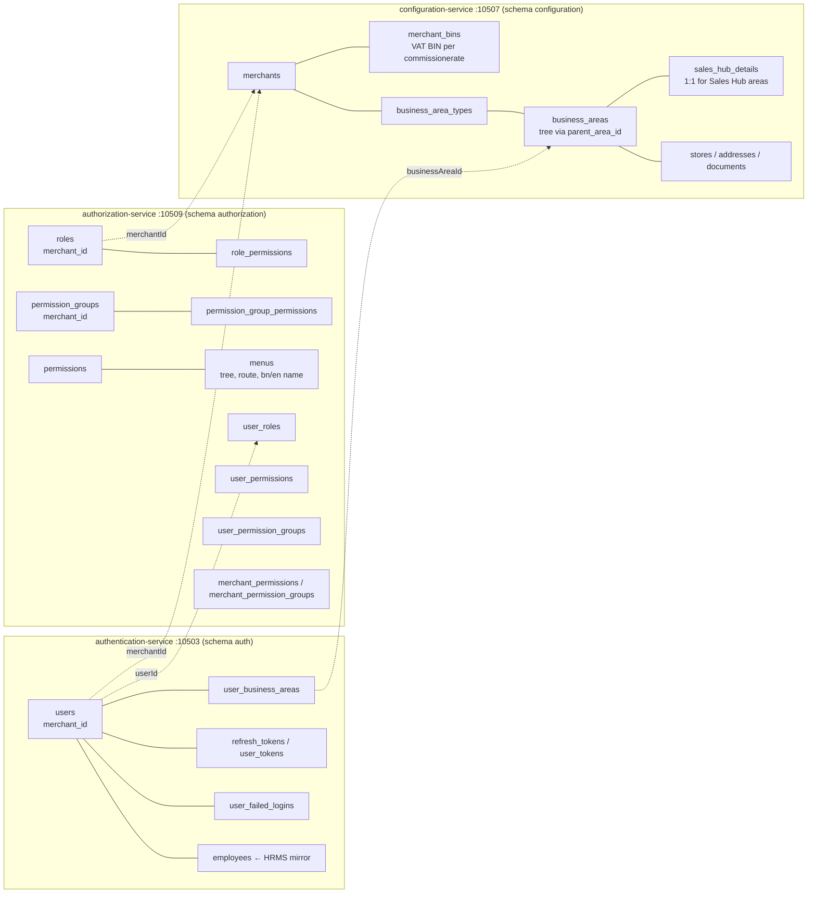
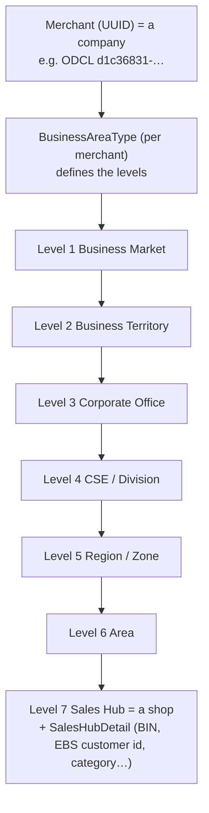
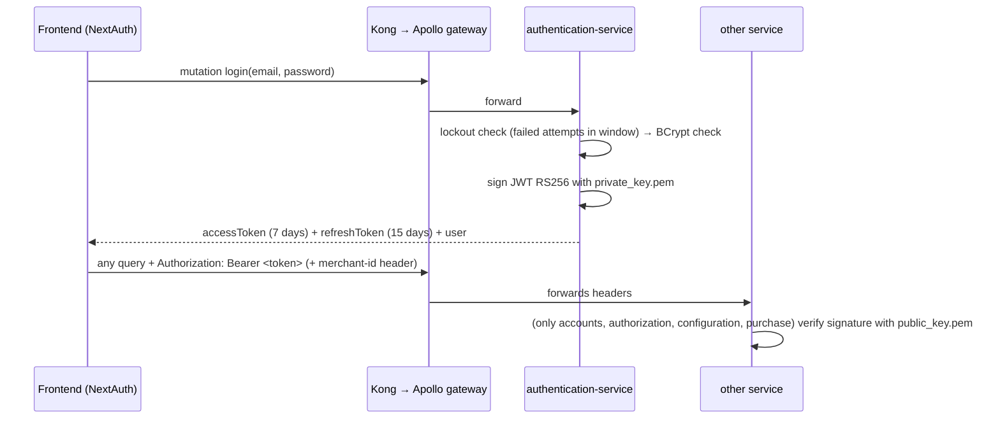

# 02 — Identity & Tenancy (authentication · authorization · configuration)

> Status: **in progress** (code + ERD read; needs your review). Last updated 2026-10-17.
> Code: `dev` branch of each repo, last commits 2026-10-14. ERDs: `authentication-service.pdf`, `authorization-service.pdf`, `configuration-service/configuration-service-v2.pdf`.

## 1. The three services in one picture

All links **between** services are plain IDs (no foreign keys across databases).

## 2. Tenancy model — how Walton Plaza, WES and ODCL are kept apart

- **Merchant** = company / sister concern. Seeded with fixed UUIDs in `configuration-service/.../merchant/initializer/MerchantDataInitializer.java`:

| Code | Name | UUID |
|---|---|---|
| WDN | Walton Distribution Network (system / super-admin merchant) | `00000000-0000-0000-0000-000000000000` |
| WHAP | Walton Home Appliance (HAP) | `194bdbb0-…` |
| **WPLZ** | **Walton Plaza** | `13e00462-3870-4d35-8cfc-72a669bf6f27` |
| WHAP | Walton Home Appliance | `85395a84-…` |
| **WES** | **Walton Electric Solutions** | `7ba1e983-a3fe-45a1-b053-4077512ceddb` |
| CSD | Corporate Sales Division | `896cf9be-…` |
| **ODCL** | **One Direction Company Limited** | `d1c36831-ae73-4027-b018-6e76b0d26eba` |

- **ODCL today**: the merchant row and **4 VAT BINs** (`006148903-0101…0104`, short codes `ODCL-0101…0104`) are seeded (`db-migration-merchant-bin-seed.sql`). **No business-area hierarchy and no sales hubs exist for ODCL** in any seed file — Walton Plaza and WES have full trees (e.g. `Walton Plaza Bogura`, `WES Bogura BSCIC Sales Hub`). Expotech's structure has to be designed (→ Q15).
- **BusinessArea** (Integer id, recently migrated from UUID): one tree per merchant. The level comes from the **type name** (`BusinessAreaType.hierarchyLevelOf`, a fixed name→level map), not a column. Rule: top level has no parent; children must be of the same merchant at a deeper level (levels can be skipped).
- **Sales Hub** = a leaf business area with a `SalesHubDetail` row: `merchantBinId` (which VAT registration it sells under), `ebsCustomerId` (the shop is a customer of Walton Hi-Tech's Oracle EBS), `salesHubCode`, category SILVER/GOLD/PLATINUM, cluster level, `accStartDate`/`salesStartDate`, upazila, GPS.
- Transaction data in other services is keyed by `sales_hub_id` (Integer); setup data by `merchant_id`.

## 3. Login & token

- **Access token claims**: `sub` = email, `userId`, `merchantId`, `businessAreaIds` (list of Integer), `kid` header. **No role/permission claims and no `isSuperAdmin` claim.**
- **Lifetimes**: access **7 days** (code comment says "30 seconds" — outdated), refresh **15 days**. Tokens stored in `user_tokens` / `refresh_tokens` (can be revoked).
- `validateAccessToken`, `refreshAccessToken`, `forgotPassword`/`resetPassword` (token-based), `changeUserPassword`, `getJWKS` (publishes the public key as JWKS — ready for gateway-level verification, not used yet).
- Lockout: `MAX_FAILED_ATTEMPTS` within `LOCKOUT_DURATION_SECONDS` → `AccountLockedException`.
- `getKongSecret` → calls a hard-coded **ngrok URL** (dead experiment).

### Which services actually check the token
| Service | Verifies JWT? | How |
|---|---|---|
| accounts, authorization, configuration, purchase | **Yes** | `JwtDecoderConfig` (public key from `jwt.public-key`) + `oauth2ResourceServer` + `@Authenticated` (= `isAuthenticated()`) on resolvers (accounts 90, configuration 62, authorization 48, purchase 127 uses) |
| authentication | partly | own `JwtUtil`; `@Authenticated` on 7 resolvers |
| sales, inventory, product, customer, payment, vat, policy, promotion, report, approval | **No** | `@EnableMethodSecurity` but no resource-server config → anyone who reaches them is anonymous-but-allowed |

> Correction to session 1: it's not "no service verifies the token" — **4 services do**; the other ~10 don't, and Kong/gateway don't.

## 4. Authorization (RBAC)

- **Building blocks**: `Menu` (tree, route, English + Bangla name, icon, display order) → `Permission` (code, action, belongs to a menu) → `PermissionGroup` (bundle, per merchant) → `Role` (per merchant).
- **Assignments**: user ← roles, user ← permission groups, user ← direct permissions; role ← permissions / permission groups. **Merchant ← permissions / permission groups** (= which features a company has bought/enabled).
- `AuthorizationService.getEffectivePermissionIds(userId)` / `hasPermission(userId, code)` / `isAdmin` compute the union.
- **Where it's used**: mainly the **frontend menu** — `(protected)/layout.tsx` calls `getAllMenusForCurrentUser` and builds the sidebar. **No backend resolver checks a permission code** (`@PreAuthorize` only means "logged in"). So permissions hide menus; they don't block API calls.
- **Kafka**: authentication publishes `user-roles-topic`, `user-areas-topic`, `user-deleted-topic`, but **authorization-service has no Kafka listener in its current code** (the `authz-group` lag of 9 on the server comes from an older version). So those events are currently unused. (Correction to 08-servers note.)

## 5. Merchant scoping in code (configuration-service as example)

`SecurityUtil` (configuration, same idea in accounts/purchase):
- `merchantScope(requested)`: returns **the requested merchantId if one is passed**, else the caller's token merchant; super admin with nothing requested → **all merchants**.
- `requireSuperAdmin(op)`: 25 operations (e.g. editing merchants) need super admin.
- Super admin can pick a merchant via the **`merchant-id` header**.

⚠ Findings:
1. **Any logged-in user can read another merchant's data** by passing that merchant's id (`merchantScope` doesn't check the caller is allowed). Tenant isolation is by convention, not enforced.
2. The token has **no `isSuperAdmin` claim**, but configuration reads `isSuperAdmin`/`isMerchantSuperAdmin` claims → on the current dev code **nobody is super admin in configuration-service** (the 25 `requireSuperAdmin` operations would always be denied) — unless the token gets this claim elsewhere. The frontend decides super admin by comparing the merchant id with the `SUPER_ADMIN_ID` env (= zero UUID). → Q16.
3. Services without JWT verification take `merchantId` purely from the request (argument or `merchant-id` header).

## 6. HRMS integration (Walton-specific)
- `employees` table mirrors Walton HRMS (`EmployeeSyncApiClient` → `/api/v1/partner/employees`, `IntegrationSyncState` tracks last sync). Users link to employees via `user_employee_references` (`source_system` = HRM/SAP/WORKDAY).
- **Schedulers are commented out** → sync is currently manual/disabled.
- ⇒ For ODCL: HRMS is Walton's; ODCL needs its own employee source or create users directly.

## 7. ERD vs code differences

| Area | ERD says | Code has | Comment |
|---|---|---|---|
| auth `users` | `business_area_id`, `sales_hub_id` columns | `user_business_areas` list (many areas per user) | code is newer/better |
| auth | `organizations`, `user_organizations` (teams doing tasks like online queries) | — | **not implemented** |
| auth | `password_recovery_codes` | `PasswordResetToken` (token link) | different approach |
| auth | — | `employees`, `integration_sync_state`, `outbox_events` | HRMS sync + outbox not in ERD |
| auth `user_working_location_history` | `business_area_id`, `sales_hub_id` | `businessAreaId` is still **UUID** | missed in the UUID→Integer migration (bug) |
| config | `business_area_details`, `business_area_stores/address/documents` ("previous sales_hubs") | still `sales_hub_details`, `sales_hub_stores`, `sales_hub_address`, `sales_hub_documents` | **ERD v2 (Oct 5) is ahead**: a rename is planned, not yet in code |
| config | `opening_entries`, `system_parameters` (scope BIN/SALES_HUB/STORE/TERMINAL/USER), `version_history` | same | ✓ |

## 8. What this means for ODCL (notes for later)
- Tenancy design is already multi-company → ODCL can either keep using the merchant model (its own merchant id) or run single-merchant.
- Must create: Expotech business-area tree + sales hubs (+ `SalesHubDetail` with ODCL BIN, EBS customer id?), roles/permission groups for ODCL, users.
- Must replace/disable: HRMS sync, Kong ngrok code; generate **new RSA key pair** (`private_key.pem`/`public_key.pem`).
- Should fix before relying on it: token verification in all services, merchant scope check, super-admin claim.
