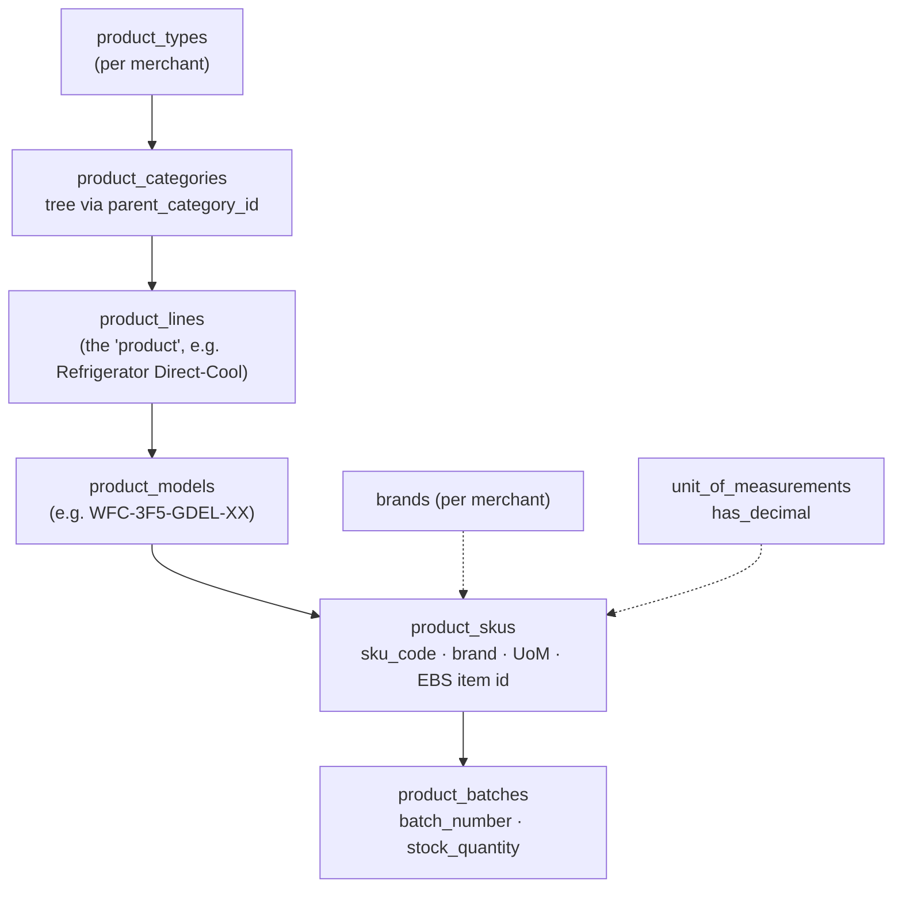
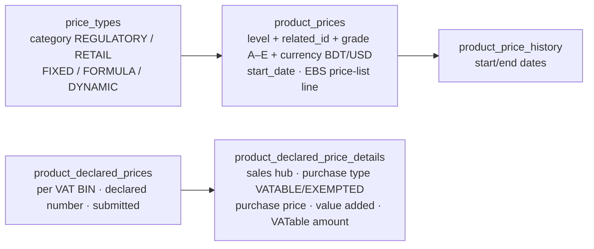
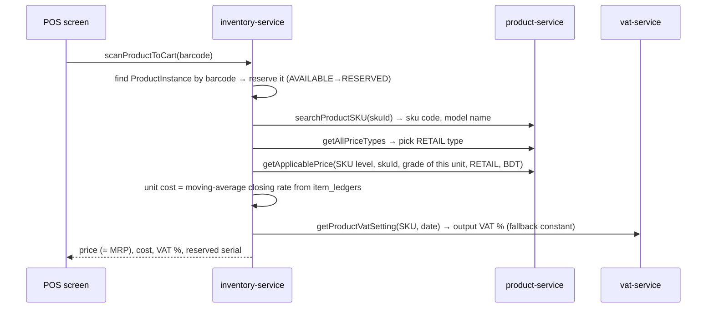
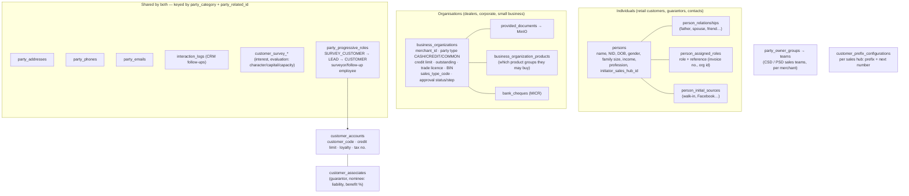

# 03 — Master data (product-service · customer-service)

> Status: **written, awaiting your review**. Last updated 2026-10-17.
> Code: `dev` branch — product-service (last commit 2026-10-13), customer-service (2026-10-15). ERDs: `product service/product-service-v2.pdf` (Aug 24), `customer service/customer-service-v5.1.pdf`.

---

## Part A — product-service (:10501, schema `product`)

### A1. The product tree

Five levels, described in `product_hierarchy_level_definitions`: **CAT → PL → MOD → SKU → BAT** (Integer ids, `hierarchy_sequence`, `is_leaf_level`).

### A2. "Attach anything to any level": the `hierarchy_level_id + related_id` pattern

Many tables don't point at a SKU directly. They point at **any level** of the tree using two columns: the level (CAT/PL/MOD/SKU/BAT) and the id of that row. This lets a setting be defined once on a category and apply to everything below it.

| Table | What it holds | Attached to |
|---|---|---|
| `business_controllers` | must declare price? taxable? VATable? barcode mandatory? | any level |
| `stock_controllers` | min/max/safety stock, GRN required, transfer allowed, FIFO, has manufacturing date, low-stock alert, country of origin | any level |
| `product_attributes` (+ predefined values, assigned values) | free attributes such as "Battery capacity", with control type (textbox/dropdown…) | any level |
| `product_images` | image URL (MinIO) | any level |
| `product_prices` / `product_price_history` | price | any level |

⚠ **Inheritance is not implemented in code.** Lookups are *exact* matches. Example: `getApplicablePrice(level, relatedId, grade, priceType, currency)` finds only a row on exactly that level, and doesn't fall back to model → line → category. In practice prices are kept on the **SKU** level.

### A3. Prices

- **Grade level A–E** sits on each price, so the same SKU can have different prices for grade A, B and so on. This is Walton's product grading. Inventory reads the grade from the physical unit.
- **Declared price** is the VAT price declaration (Mushak 4.3) per BIN: purchase price + value added = VATable price. Checked against configuration-service (BIN, sales hub). This is needed for Bangladesh VAT, so **ODCL needs it too**, with its own BINs.
- `getApplicablePrice` ignores `start_date`. If several rows match, the result is undefined (repository `findBy…` returns an Optional, so it fails on duplicates).
- `product_price_ledger` (entity + service) is **fully commented out**.

### A4. How a price reaches the till

The sales service does **not** call product-service. The price comes through inventory when the cashier scans a unit:

⇒ The design assumes **every unit sold has its own barcode/serial** (`ProductInstance`), which fits electronics. More on this for ODCL in A7.

### A5. Consumables (for internal use at the sales centre)

`consumeable_categories` (FAST / SLOW / ON_DEMAND, requires approval, track waste) → `consumable_items` (unit, divisible, track inventory, min stock, reorder qty, reusable, has expiry, expiry days) and `consumable_suppliers` (payment terms).
The ERD says these are "consumable items **to use from sales center**": tea, paper, cleaning supplies. They are not sold. Inventory has a matching `ConsumeableStock`.

### A6. Integrations and events
- Outbound: **configuration-service** (merchant BIN, sales hub check for declared price), **purchase-service**. MinIO for images.
- **No Kafka** in product-service.
- Callers: inventory (SKU, price, batch, consumables, stock controller), customer, promotion, authorization (WebClient config), and the frontend directly.
- Federation `@key` on ProductSKU, ProductLine, DeclaredPrice, attribute values, ConsumableSupplier.
- Walton-specific: `ebs_inventory_item_id`, `ebs_item_code`, `operating_unit_id`, `enterprice_sku_id`, `enterprice_price_list_line_id`. These link to **Walton's Oracle EBS**. ODCL doesn't have EBS, so they will stay empty.
- `merchant_id` lives on `product_types`, `brands`, `product_categories`, consumables. **SKU, model and line have no merchant_id** (it's inherited through category).

### A7. ERD v2 vs code

| Area | ERD | Code | Comment |
|---|---|---|---|
| `product_skus` | sku_code, model, brand, operating unit, EBS id | + `is_hot_sale`, `ebs_item_code`, `product_type_id`, `uom_id` | code is ahead |
| `unit_of_measurements` | uom_name, description | + code, symbol, uom_type, **has_decimal** | code is ahead |
| hierarchy | `product_hierarchy_levels` (Integer) | **two** tables: old `product_hierarchy_levels` (UUID, `HierarchyLevel`) + new `product_hierarchy_level_definitions` (Integer) | leftover of a migration |
| `product_price_ledger` | — | entity commented out | dead |
| consumables ids | BIGINT | UUID | minor |
| constraint "all SKUs under a model have the same brand" | stated | not enforced in code | — |

### A8. ⭐ What this means for Expotech (restaurant + BOM)

Expotech sells **restaurant items made from raw materials** (coffee, tea, food). Compared with what product-service has today:

| Need | Exists? | Notes |
|---|---|---|
| Sellable menu item (Coffee, Tea) | 🟡 as a SKU | Fits the tree (Type → Category "Beverage" → Line → Model → SKU), but 5 levels are too many for a menu. Category + SKU would do. |
| Raw materials (beans, milk, sugar, cups) | 🟡 | Either as SKUs or as `consumable_items`. Consumable units are only **PCS / PACK / BOX / BOTTLE**: no kg, g, litre or ml. The `unit_of_measurements` table is flexible (has `has_decimal`). |
| **Recipe / BOM** (1 coffee = 18 g beans + 150 ml milk + 1 cup) | ❌ **missing** | No table links a SKU to its components. New tables needed, e.g. `bom_headers` (sku, yield, version, valid from) + `bom_lines` (component sku/consumable, qty, UoM, wastage %). |
| Unit conversion (buy in kg, use in g) | ❌ | No conversion table. |
| Selling without a serial per unit | ❌ in inventory | The scan flow needs a `ProductInstance` per unit (A4). Restaurant sales need **quantity-based** stock, with ingredients deducted when the sale is confirmed. → session 4. |
| Modifiers (extra shot, no sugar, size S/M/L) | ❌ | Could start as attributes/variants; true modifiers would be new. |
| Price by item (no grade) | ✅ | Use one grade (A) and price type RETAIL at SKU level. |
| Declared price (Mushak 4.3) | ✅ | Restaurants have special VAT rules in Bangladesh → check in session 6 (vat). |

---

## Part B — customer-service (:10504, schema `customer`)

### B1. Party model

- **`party_category` + `party_related_id`** is the same "pointer to anything" trick as in product: one address/phone/email table serves both persons and organisations.
- **Retail walk-in customer** = a `person` + a phone, optionally a `customer_account` with a generated code (`customer_prefix_configurations` per sales hub + BIN short code).
- **Dealer/corporate** = a `business_organization` that goes through **approval** (`approval-request-create-events` → approval-service → back on `approval-events` / `approvalRequest-events`) before `is_approved`.
- CRM features: surveys, interaction log, interest in products, progressive roles (lead → customer), owner groups and teams.

### B2. Events

| Direction | Topic | What |
|---|---|---|
| produces | `customer-events` | survey-customer created (Spring event → Kafka bridge, **no outbox**) |
| produces | `approval-request-create-events` | business organisation needs approval |
| consumes | `approval-events`, `approvalRequest-events` (group `customer-service-group`) | approval id / final status back from approval-service |

Reminder from session 1: sales-service also uses group `customer-service-group`, so it competes with customer-service for messages.

Outbound GraphQL: accounts, approval, authentication, configuration, product.

### B3. Tenancy gap
- `persons` has **no `merchant_id`** (same in ERD), only `initiator_sales_hub_id`. A person is a shared, cross-company record. Organisations and owner groups **do** have `merchant_id`.
- ⇒ For a data split, ODCL's customers can only be found through `initiator_sales_hub_id` → business area → merchant, plus the invoices that reference them.

### B4. ERD v5.1 vs code

| ERD | Code | Comment |
|---|---|---|
| `kisti_surokkha_cards` (prev. `customer_surokha_cards`), `hire_investigation_reports`, `person_associated_members` | — | **Hire-related, not implemented. Not needed for ODCL.** |
| — | `customer_accounts`, `customer_associates`, `customer_associated_relations`, `customers_opinion_settings`, `customer_assigned_opinions`, `person_roles`, `person_role_types`, `relationships` | in code; customer accounts and guarantors (associates) serve credit, EMI and Hire sales |
| `credit_status`, `marital_status` enums | enums in code | ✓ |
| rest (party_*, business_organizations, surveys, interaction logs, owner groups, prefix config) | same | ✓ |

### B5. For ODCL
- Retail restaurant customers: you need **person + phone** (and maybe a loyalty value). Most of the CRM, survey, guarantor and dealer approval features won't be used.
- Prefix configuration must be set up for Expotech's sales hub.
- If ODCL ever does credit/corporate customers, the business organisation + approval flow is ready.

---

## User answers (2026-10-17)
- Recipes = **fixed BOM** per menu item → a simple `bom_header` + `bom_lines` is enough to start (no modifier engine).
- **Packaged items exist** alongside made-to-order items → two item kinds: *stocked* (bought and sold as is, own barcode, quantity stock) and *made-to-order* (BOM, ingredients deducted on sale).

## Open points from this session
- Q22 (BOM details) and Q23 (Expotech item counts) in `questions-for-you.md`.
- Verify in session 4: inventory's quantity-based (non-serial) stock and how consumables are issued/deducted.
- Verify in session 6: restaurant VAT rules in vat-service.
