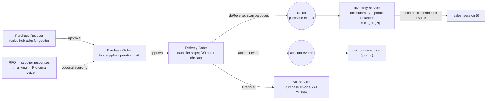
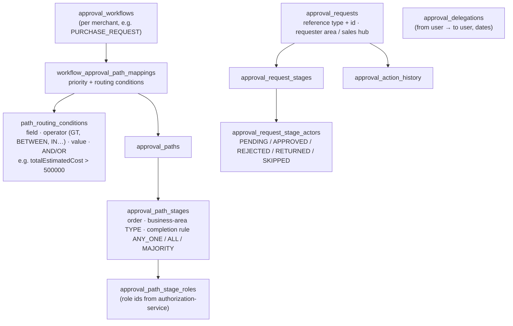
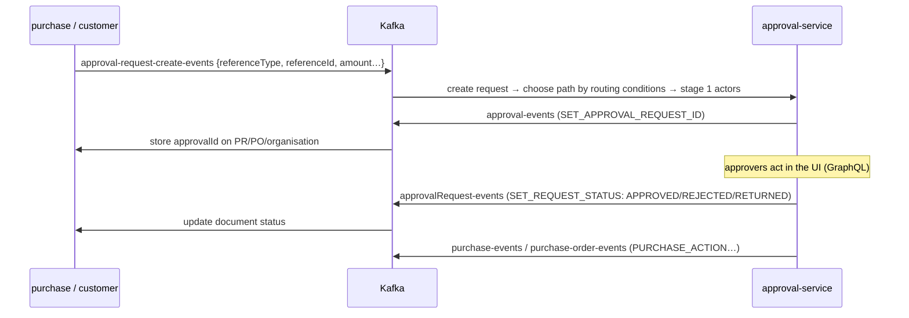
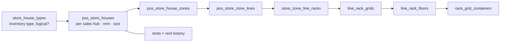
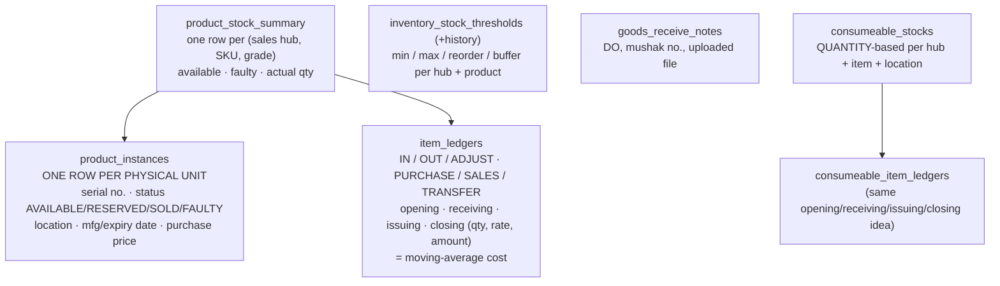
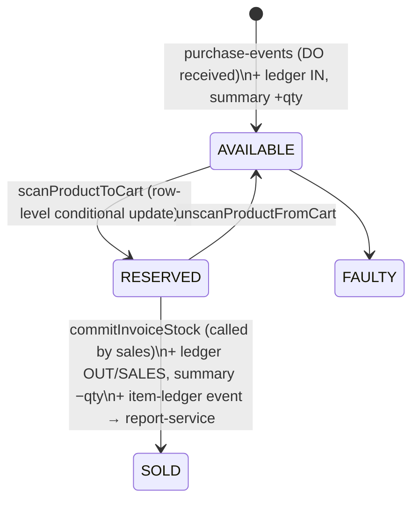

# 04 — Procure → stock (purchase · approval · inventory)

> Status: **written, awaiting your review**. Last updated 2026-10-17.
> Code: `dev` branch — purchase-service :10508 (2026-10-15), approval-service :10519 (2026-10-14), inventory-service :10513 (2026-10-07).
> ERDs: `purchase/purchase-service -v3.pdf`, `approval-service.pdf` (Apr — older than the code), `inventory service/inventory-service-v1.pdf` (Jun — stale).

## 1. The whole flow on one page

In Walton's real setup the supplier is **Walton Hi-Tech** (via EBS). The `supplier_operating_units` hold Walton Hi-Tech's operating units (BIN, VAT address, VAT %), and the DO carries the plaza's `ebs_customer_id`.

---

## 2. purchase-service

### 2.1 Documents and statuses

| Document | Table(s) | Status values |
|---|---|---|
| Purchase Request (PR) | `purchase_requests` + `_items` (+ history, audit logs) | DRAFT → SUBMITTED → APPROVED / REJECTED / RETURNED → PARTIALLY_FULFILLED → FULFILLED |
| Request for Quotation | `request_for_quotations` + products, `rfq_response` + products | RfqStatus |
| Supplier ranking | `sourcing_ranking_criterias` (weight %) → `supplier_ranking_scores` | — |
| Proforma Invoice | `proforma_invoices` + items | ProformaInvoiceStatus |
| Purchase Order (PO) | `purchase_orders` + `_items` (+ audit logs) | draft → submitted → approved / rejected / returned |
| Delivery Order (DO) | `delivery_orders` → `do_product_controllers` (one per SKU + grade line) → `delivery_order_items` (**one per barcode**) | DO: PENDING → PARTIALLY_RECEIVED → RECEIVED / CANCELLED; item: NEW → RECEIVED |
| Service procurement | `service_rfqs` → `service_rfq_responses` → `service_proforma_invoices` → `service_purchase_orders` | for buying services, not goods |

Supplier master: `product_supplier_types` → `product_supplier_groups` → `supplier_legal_entities` → `supplier_operating_units` (all with `merchant_id`).

Items point at products with the usual **level + related_id** pattern (SKU in practice). Each DO line also carries **grade A–E**, unit price, VAT, tax and **Mushak price**.

### 2.2 Receiving goods (`doReceive`)
1. The user scans each barcode, **or** gives a starting barcode + quantity. `generateBarcodes` then creates sequential barcodes, e.g. `ABC0001…ABC0100`.
2. Each `delivery_order_item` becomes RECEIVED.
3. An outbox row is written → **`purchase-events`** → inventory. ⚠ The outbox `aggregateId` is a **hard-coded UUID** (`56044de9-…`).
4. Account event → **`account-events`** → accounts-service.
5. Synchronous GraphQL call → vat-service `createPurchaseInvoiceVat` (Mushak purchase register). If it fails, it's only logged.

### 2.3 Integrations
- GraphQL out: product, configuration, authentication, approval, vat.
- Kafka out: `purchase-events`, `account-events`, `approval-request-create-events`.
- Kafka in (group `purchase-service-group`): `approval-events`, `approvalRequest-events`, `purchase-events`, `purchase-order-events`.
- ⚠ **Bug:** `approval.url` in purchase's prod/local config points to **port 10505**, but approval-service runs on **10519**. The direct GraphQL calls from purchase to approval fail; only the Kafka path works.
- One of the 4 services that verify the JWT (session 2).

---

## 3. approval-service — generic approval engine

Used by: **PURCHASE_REQUEST, PO_REQUEST, SALES_HUB_TRANSFER, AMEND_CREDIT_LIMIT, BUSINESS_ORGANIZATION** (customer dealers).

**How the approvers are found** (`StageActorResolver`):
1. Take the requester's business area and walk **up** the area tree (configuration-service).
2. Start at the level named by the stage's business-area type (e.g. "Region").
3. Approvers = users who have **one of the stage's roles** (authorization-service) **and** are assigned to that area (authentication-service `user_business_areas`).

That's why tenancy (session 2) matters here: approvals follow the org tree.

**Message round trip:**

**Two generations side by side:** the ERD (April) only has the *old* model: `approval_path_roles`, `approval_path_role_users` (+ history), `approval_steps`, `approval_logs`. The code still has those tables and services, plus the *new* stage/actor/routing model above. The new one is the active path in `ApprovalRequestServiceImpl`. ERD needs updating.

Reminder (session 8): on the dev server approval-service runs with **no profile env**, so it falls back to `local` + `db-pos-dev`.

---

## 4. inventory-service

### 4.1 Where things are stored (physical layout)

Up to 7 levels deep: store house → zone → line → rack → grid → floor → container. Built for warehouses/showrooms, so a restaurant would use 1–2 levels at most.

### 4.2 Stock model

### 4.3 Life of a unit

- **Package sale:** scanning with `isPackageSale` + qty walks forward through sequential barcodes (last 4 chars = carton position) and reserves up to qty units.
- Stock summary counters only move on purchase receipt and on invoice commit, not on scan.

### 4.4 Findings
- ⚠ **Sale ledger mixes prices:** the OUT row uses **MRP (selling price)** as the issuing rate, while the opening/closing use **cost**. So opening amount − issued amount ≠ closing amount, and the ledger doesn't balance in money terms. Cost of goods sold must be computed elsewhere (accounts? check in session 6).
- The outbox poller in inventory is **commented out**. Events are sent directly with `kafkaTemplate`.
- `ConsumeableIssue`, `ConsumeableRequest`, `ConsumeableItem`, `ConsumeableCategory` classes in inventory are **empty stubs**. Issuing consumables isn't built; only consumable *stock* + *ledger* exist.
- Tests are all commented out (per the repo's own CLAUDE.md).
- `createdBy` / `updatedBy` hard-coded "ADMIN".
- Inventory doesn't verify the JWT.

### 4.5 ERD vs code
| ERD | Code | Comment |
|---|---|---|
| purchase v3: `product_suppliers` | `product_supplier_groups` → `supplier_legal_entities` → `supplier_operating_units` | code added a supplier hierarchy (fits Walton Hi-Tech's OUs) |
| purchase v3: `service_invoices`, `*_products` tables | `*_items` naming, no `service_invoices` | naming drift |
| approval (Apr): steps/role-users model | + stages / actors / routing conditions / delegations / action history | **ERD outdated** |
| inventory v1: no stock summary | `product_stock_summary` central | ERD stale; code is the truth |

---

## 5. ⭐ For Expotech (restaurant + packaged goods)

| Need | Today | Gap / idea |
|---|---|---|
| Buy from local suppliers (milk, beans, snacks) | PR → PO → DO exists with approval | ✅ usable. For one shop the approval path can be one stage (manager), or skip approval. Supplier master works (legal entity → operating unit is heavy but OK). |
| Supplier is **not** Walton/EBS | DO has `ebs_customer_id`, Mushak price | fields just stay empty; check that nothing requires them |
| **Packaged items with barcode** (water, chips) | every unit = `product_instance` row; receive by start barcode + qty generates **sequential fake serials** | ⚠ Manufacturer barcodes (EAN) are the same on every bottle, so they can't be unique serials. Needs **quantity-based** stock for non-serial items: sell by EAN, decrement `product_stock_summary` directly. |
| **Raw materials** (beans in kg, milk in L) | `consumeable_stocks` + `consumeable_item_ledgers` are already quantity-based with moving-average rate | 👍 Best starting point for ingredients, but consumable units are only PCS/PACK/BOX/BOTTLE and there's no issue flow (stubs). |
| **Deduct ingredients on sale (BOM)** | nothing | new: on invoice commit, for each made-to-order item → look up BOM → write OUT rows to ingredient ledger |
| Wastage / spoilage | `track_waste` flag only | new adjustment type (ADJUST exists in enum) |
| Warehouse layout | 7-level rack model | use only store house (kitchen, store room) |

**Conclusion:** purchasing and approval can be reused almost as is. Inventory needs a **second, quantity-based selling path** (non-serial items + BOM ingredient deduction). That is the biggest functional change ODCL will need.

## User answers (2026-10-17)
- Many local suppliers (no fixed one); **approval needed** → reuse PR/PO + approval with a simple path.
- **Expiry tracking** for packaged items and a **daily stock count** are needed. `product_instances.expiry_date` and `stock_controllers.has_manufacturing_date` exist, but there's no FIFO-by-expiry picking and no stock-count/adjustment screen → new work.
