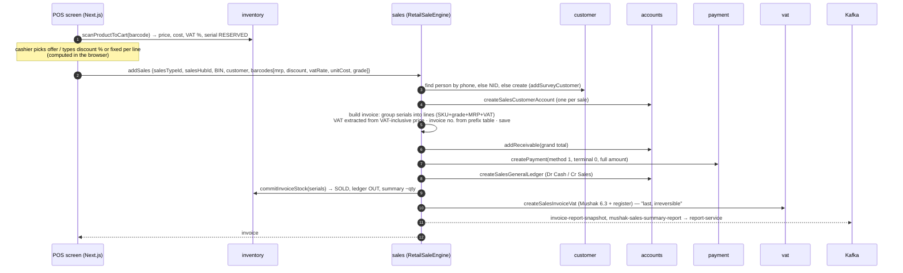
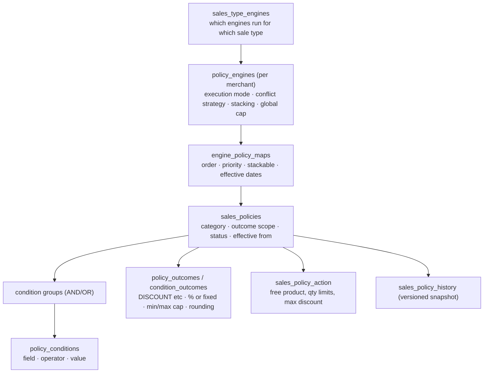

# 05 — Sell (sales · policy · promotion · payment). Hire skipped.

> Status: **written, awaiting your review**. Last updated 2026-10-17.
> Code: `dev` branch — sales-service :10514 (2026-10-13), policy-service :10511 (2026-09-23), promotion-service :10506 (2026-10-05), payment-service :10516 (2026-10-12). Frontend `components/protected/sales/sale/retail-sales/`.
> ERDs: `sale/sales-service-v2.pdf`, `policy/policy-service-v2.pdf`, `promotion/promotion-service.pdf`, `payment-service/payment-service.pdf`.

## 1. Sale types and engines

`sales_types` (code, parent, `default_engine`, `allowed_engines`, routing mode). The single mutation **`addSales(input)`** looks up the sales type and hands over to its engine (`SalesOrchestrationServiceImpl`):

| Engine | Class | For ODCL |
|---|---|---|
| `RETAIL_ENGINE` | `RetailSaleEngine` | ✅ **main one** |
| EMI | `EMISaleEngine` (extends retail, saves EMI bank/card/commission in `sales_invoice_retail_extensions`) | not now (Q9) |
| Dealer | `DealerSaleEngine` | probably not |
| Hire | `HireSaleEngine` (689 lines) | ❌ out of scope |

Old path `SalesServiceImpl.addSales` still exists but **no resolver calls it**.

## 2. A retail sale, end to end

### Data
- `sales_invoices` (number, type, hub, terminal, MRP total, discount, additional discount, VAT, grand total, cash received, customer account id, offer) → `sales_lines` (SKU, grade, MRP, **quantity Integer**, discounts, VAT rate/total, unit cost, price-history id) → `sales_serial_numbers` (barcode, colour, purchase price, status).
- Extensions per type: `sales_invoice_retail_extensions` (EMI, mobile banking, card, reference sale, MICR cheque), gift voucher, hire.
- Invoice numbers come from `transaction_prefix_configurations` (per sales hub + BIN short code, next sequence, length 8).
- Other tables: `sales_offers` (just a title + dates + sales type), sales targets (yearly/monthly/heads), sales-hub incentive settings, processing fee ranges, `policy_execution_logs`.

### ⚠ Findings
1. **The server trusts prices from the browser.** MRP, discount, VAT rate and unit cost all come in the request, and sales doesn't recheck them against product-service. Until 24 Oct 2026 sales-service didn't verify the JWT either, so anyone who could reach it could post a sale at any price. It now requires a login token (29 of 33 resolver classes), but any logged-in user can still post any price.
2. **No distributed rollback.** Up to 7 other services are called one after another. If step 6 fails, the local invoice rolls back, but the customer account, receivable and payment already created in other services stay. The code says "Remote compensation still pending".
3. **A new customer account is opened in accounts for every sale**, even for the same person.
4. **Payment is hard-coded:** method 1 (cash), terminal 0, full amount. No split payment (cash + card) and no change calculation, although payment-service's data model supports split payment (`payment_details`).
5. **Money is `Double`** in sales (BigDecimal in payment/purchase). Rounding is done by hand (`round2`).
6. **Discounts are manual.** The cashier types a % or fixed amount per line, and offers are only a label. **policy-service and promotion-service are not called** during a sale (no config URL, no frontend call).
7. **Returns** (`sales_returns`, lines, serials, refund mode) only store records. No stock-back to inventory and no refund in payment.
8. sales' config has `order-service:10508`, but 10508 is purchase-service (order-service runs on 10515).
9. `sales-invoice-created` (one message per serial, used by promotion's warranty `registered_products`) is only published by the **unused** old path, so registered products are never filled. Also promotion's Kafka IP typo (session 1).

---

## 3. policy-service — rule engine (not connected yet)

- Evaluation: `SpelEvaluationService` turns conditions into Spring SpEL expressions (prototype in the `Rule_parser_SpEL` repo).
- GraphQL: `evaluatePolicies`, `evaluatePolicy`, `evaluateByEngine`, `evaluateForSalesType(salesTypeCode, data) → FinalInvoice`.
- **No service or frontend calls these today.** It's a finished-looking engine waiting to be wired into the sale.
- Business rules it's meant to encode: the Walton Plaza "evaluation & benefit distribution policy v6" PDF. **Expotech has its own policy** (Q9), and the engine is generic, so ODCL can configure its own rules.

## 4. promotion-service — loyalty, discounts, promo codes, warranty registration

| Area | Tables |
|---|---|
| Discount rules | `discount_rules` (level + related id, value, min/max qty, dates, priority) |
| Bonus products | `product_offerings` (buy X get Y, by channel) |
| Promo codes | `promotional_code_offers` (code, mobile, OTP, **surokha card**, CSD party) |
| Loyalty | `loyalty_programs` (points per taka, redemption rate), `loyalty_tiers`, `customer_loyalty`, `customer_loyalty_points`, ledger, rewards, redemptions |
| CRM | `customer_preferences`, `customer_feedback` |
| Product registration (warranty) | `registered_products` (fed by `sales-invoice-created`) |

**Not called during a sale either.** The Kafka listener is broken (wrong IP, wrong group on `purchase-events`). For a restaurant, **loyalty points** and simple **discount rules / happy hours** are the useful parts.

## 5. payment-service

`payments` (number, hub, customer account, terminal, total, currency, type SALE/DUE/ADVANCE/REFUND, status) → `payment_details` (one per method: **CASH / CARD / MOBILE / BANK / STRIPE**, transaction ref) → `payment_allocations` (to invoice/receivable). Also `refunds`, `bank_deposits`, status/audit logs, prefix config.

ERD has but code **doesn't**: `cash_sessions`, `cash_handovers`, `cash_clearances` (**till open/close, shift handover**), `gift_cards` (+ policies, transactions), `customer_due_snapshots`.

---

## 6. ERD vs code (summary)
| ERD | Code |
|---|---|
| sales v2: matches (invoices, lines, serials, extensions, returns, targets, incentive, fees, prefix, offers, policy logs) | ✓ |
| policy v2: matches; code also has `condition_type_meta`, `policy_types`/details, `sales_policy_action`, `sales_policy_target`, `policy_operators` | code ahead |
| promotion: matches | ✓ |
| payment: cash sessions/handovers/clearances, gift cards, due snapshots | **not built** |

## 7. ⭐ For Expotech (restaurant, mostly retail, own policy)

| Need | Today | Gap |
|---|---|---|
| Fast counter sale | Retail engine works, but needs a phone/NID customer and 7 synchronous calls | allow **walk-in (anonymous) customer**; fewer calls per sale |
| Sell by quantity (2 coffees) without serials | lines group serials; stock commit is serial-only | quantity lines + BOM deduction (see 03/04) |
| Price from master, not from browser | browser sends price | look up price on the server |
| Split payment, change, cash/card/bKash | hard-coded cash | use `payment_details`; send method from UI |
| **Till / shift close (cash session)** | only in ERD | build `cash_sessions` / handover |
| Own discount rules / happy hour | policy & promotion engines exist but unwired | wire `evaluateForSalesType` into the sale, configure Expotech rules |
| Loyalty points | promotion has the model | wire into sale |
| Returns / void | record only | stock-back + refund |
| Restaurant extras: table/order, kitchen ticket (KOT), hold & recall bill | ❌ nothing (order-service on the server may be related; repo pending from your manager) | new |
| VAT on restaurant sales | VAT from VAT-inclusive MRP, Mushak 6.3 | check restaurant VAT rules in session 6 |

## User answers (2026-10-17)
- Service model: pay-first, maybe also table service → to clarify with Expotech.
- Payment: **cash, card, mobile (bKash/Nagad), split payments, and daily till close are all needed** → payment wiring and cash sessions are must-haves.
- Phone on bill probably not required (to confirm) → walk-in customer support needed.
