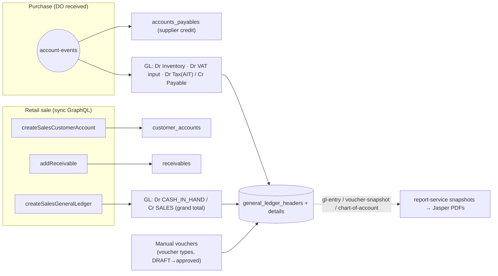
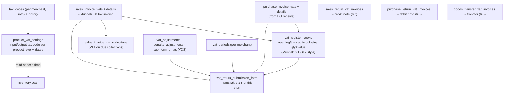

# 06 — Finance & compliance (accounts · vat · report)

> Status: **written, awaiting your review**. Last updated 2026-10-17.
> Code: `dev` branch — accounts-service :10512 (2026-10-14), vat-service :10517 (2026-10-13), report-service :10518 (2026-10-17).
> ERDs: `acount-service/accounts-service-v3.1.pdf`, `vat-service/vat-service-v2.2.pdf`, `report-service/report-service-v1.3.pdf`.

## 1. How money flows into the books

## 2. accounts-service (485 Java files, the largest)

| Area | Tables | Notes |
|---|---|---|
| Chart of accounts | `chart_of_accounts` (code, name, type, **keyword**, parent, direct-post allowed, approval status) | ⚠ **no `merchant_id`** → one COA shared by all companies |
| General ledger | `general_ledger_headers` (hub, store, transaction type/no, reference source/no, period, status POSTED) → `general_ledger_details` (COA, debit, credit, product level + id, bank, operating unit) | |
| Vouchers | `voucher_types` (per merchant: debit/credit required, approval required, max amount) → `voucher_header_info` → `voucher_details` | manual journal, payment and receipt vouchers |
| Periods | `accounting_periods` (per merchant), status + logs, `accounting_processes` | period open/close |
| Customers | `customer_accounts`, `receivables`, `customer_due_collections` (receipts, reversal) | one account per sale (session 5) |
| Suppliers | `payables`, `accounts_payables` | |
| Banking | banks, branches, bank types, `bank_accounts`, `mobile_wallets` (bKash etc. with charge rate) | |
| Expenses | `expenses` → COA | |
| Assets | asset types/categories/models/items/master, fixed, current, financial, intangible, deferred tax, misc; depreciation history; movement history | full fixed-asset register |
| EMI | `emi_allowed_months`, `emi_bank_cards`, `emi_bank_commission_rates`, `emi_machine_charges` | not needed now |
| Hire | `hire_installment_schedules` | ❌ out of scope |
| Other | `vehicles`, `vehicle_transactions` | fleet |

**Posting rules are hard-coded by COA keyword** (`SalesGeneralLedgerServiceImpl`, `AccountEventConsumerImpl`). A keyword missing from the COA makes the sale fail ("Chart-of-account not configured for keyword").

### ⚠ Accounting findings
1. **Sales journal is incomplete:** only `Dr Cash / Cr Sales` for the VAT-inclusive grand total.
   - **Output VAT is not split out** (no `Cr VAT payable`), so sales revenue is overstated by the VAT.
   - **No cost of goods sold** (`Dr COGS / Cr Inventory`), so inventory in the GL never goes down after a sale. The item ledger (session 4) also uses MRP for issues.
   - Card, bKash and split payments all post to `CASH_IN_HAND`.
2. The purchase journal is good: inventory, input VAT and AIT are separated against the payable.
3. COA shared across merchants: fine for ODCL's own system, but a problem if data must be split.
4. Money is mixed: `BigDecimal` in GL, `Double` in vouchers.
5. Listens to `account-events` (group `account-service-group`). The `account-events-sales` topic is configured somewhere but unused (session 1).

ERD v3.1 has but code lacks: `bank_transactions`, `tax_records`, `asset_item_depreciation_history`, `accounting_prefix_configurations` (as named), `surokha_card_ledgers` (Hire).

## 3. vat-service — Bangladesh VAT (Mushak) compliance

- Sale: VAT is **extracted from the VAT-inclusive MRP** (`price × rate / (100+rate)`), with fallback rate if no product VAT setting exists.
- Declared prices (Mushak 4.3) live in product-service (session 3).
- The register book is **product-quantity based** (opening/closing qty per SKU), which assumes you buy and sell the same item.

### ⭐ Restaurant VAT for Expotech (to verify with a VAT consultant)
- Restaurants in Bangladesh are generally taxed at a **reduced/flat VAT rate on the bill**, often **without input-tax credit**. The rate depends on the type of restaurant (AC / non-AC / hotel). I don't know Expotech's exact category, so please confirm.
- With recipes, raw materials are bought and **finished food** is sold, so the buy-and-sell register no longer matches item for item. Need to confirm which Mushak registers Expotech files today (their current Grails system will show this).
- The model already supports per-merchant tax codes and per-product settings, so a single restaurant rate is easy. Turning input credit off for a merchant is not modelled.

## 4. report-service — read model for reports

- **Listens** to: `invoice-report-snapshot`, `mushak-sales-summary-report` (from sales), `item-ledger-entry` (inventory), `gl-entry`, `voucher-snapshot`, `chart-of-account` (accounts).
- Stores **snapshot tables** (invoice + items, Mushak sales summary per SKU/barcode, item-ledger entries, GL transactions, vouchers, COA) so reports don't query other services' databases.
- **Jasper templates** (`.jrxml`): invoice (v1, v2), **Mushak 6.3**, voucher, cash book, account ledger, trial balance, income statement, **balance sheet** (added 2026-10-19, `generateBalanceSheetReport`), item ledger, user report, role report.
- ⚠ On the dev server it runs against the **dev DB (.200.52)** while sales writes to the demo DB (.196) (session 8, Q19). That's fine for report-service's own tables, which are filled by Kafka.
- Calls authorization for the role report.

## 5. ERD vs code (summary)
| Service | Status |
|---|---|
| accounts v3.1 | mostly matches; bank transactions, tax records, item depreciation history missing in code |
| vat v2.2 | matches (note fields such as Mushak 18.6 note 54 / 16.6 note 56 in return form) |
| report v1.3 | matches |

## 6. ⭐ For Expotech
| Need | Today | Gap |
|---|---|---|
| Correct daily sales journal | Dr Cash / Cr Sales only | split **VAT payable**, post **COGS** (from recipe cost), and post per payment method (cash / card / bKash) |
| Own chart of accounts | shared COA, posting by keyword | ODCL gets its own DB, so just seed ODCL's COA with the needed keywords |
| Expenses, vouchers, bank, trial balance, income statement | ✅ exists | reuse |
| Fixed assets (kitchen equipment) | ✅ full register | reuse if needed |
| Restaurant VAT rate + return 9.1 | generic engine | configure tax code; confirm category/registers (Q30) |
| Reports (daily sales, item-wise, Z-report per till) | invoice/item reports exist | **Z-report / shift report** needed with cash sessions |

## User answers (2026-10-17)
- **All accounting is done in this system** (no Tally etc.) → accounts-service is core for ODCL; fixing the sales journal (VAT payable, COGS, per payment method) is a must-have, not optional.
- Restaurant VAT category/rate: to ask Expotech.
