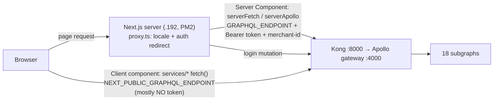

# 07 — Frontend (smartpos-web)

> Status: **written, awaiting your review**. Last updated 2026-10-17.
> Repo: `1frontend/smartpos-web`. ⚠ Your local copy is on branch **`sadat`** (a developer's branch, last commit 2026-10-15), not `dev` (`origin/dev` last merge 2026-10-12). Same for reading: what you see may be ahead of `dev`.
> The repo has its own `CLAUDE.md` (architecture) and `ONBOARDING.md` (a beginner's one-week plan). Both are worth reading.

## 1. Stack
Next.js **16.4** (App Router, Turbopack, `cacheComponents`, `proxy.ts` instead of middleware), React **19**, TypeScript strict, Tailwind v4 + shadcn/ui (`base-nova`), Apollo Client 4 + graphql-codegen, **NextAuth v5 beta**, next-intl (**en / bn**), Zustand, react-hook-form + zod, TanStack Table, recharts, tiptap. **No tests.** Runs under **PM2** as app `UniPosDev` on **192.168.20.192** (`ecosystem.config.js` is git-ignored).

## 2. Request path



## 3. Login and session
- `src/auth.ts`: NextAuth **Credentials** provider → GraphQL `login(email, password)` → stores `accessToken` + user in the NextAuth JWT cookie.
- Session `maxAge` = **4 hours** (`240 * 60`). The backend token lasts 7 days. **The refresh token isn't used.**
- `src/proxy.ts`: adds the locale prefix, sends unauthenticated users to `/{locale}/login`, and keeps logged-in users away from auth pages.
- `(protected)/layout.tsx`: loads the sidebar from `getAllMenusForCurrentUser` (session 2: permissions = menus).

## 4. ⭐ Which company? Set per deployment, not per user
`src/utils/getUserSession.ts`:
```ts
// const merchantId = user?.merchant?.merchantId;   ← commented out
const merchantId = process.env.TEMP_MERCHANT_ID;     ← from the server's env
const isSuperAdmin = merchantId === process.env.SUPER_ADMIN_ID;
```
- **The whole frontend instance works as ONE merchant**, set in `.env` (`TEMP_MERCHANT_ID` / `NEXT_PUBLIC_TEMP_MERCHANT_ID`), whoever logs in.
- "Super admin" in the UI = that env merchant is the zero-UUID WDN merchant. It's not a property of the user (`NEXT_PUBLIC_SUPER_ADMIN_ID` checked in 71 places).
- The merchant goes to the backend as the `merchant-id` header, plus `user-id` in some calls.
- ⇒ **For ODCL this is convenient:** run your own frontend with `TEMP_MERCHANT_ID = d1c36831-…` (ODCL). Longer term, take the merchant from the user's token.

## 5. Two (really three) ways to call the API
| Style | Where | Used by |
|---|---|---|
| Plain `fetch` with hand-written query strings | `src/services/{queries,mutations}/<domain>/*.ts` | **the main pattern**: 204 files use `NEXT_PUBLIC_GRAPHQL_ENDPOINT` |
| Codegen + Apollo | `src/graphql/protected/**/*.graphql` → `src/generated/graphql.ts` (git-ignored, generated at build from the live schema) | newer screens, login |
| Server helpers | `src/lib/serverFetch.ts` (cache tags), `serverActionFetch.ts`, `serverApollo.ts` | Server Components / Actions |

⚠ **202 of those 204 service files send no `Authorization` header.** This only works because most backend services don't check the token (session 2). If ODCL turns on token checking in the services, these files all need the token added, best done through one shared fetch helper.

⚠ **The build needs a running backend:** `npm run build` runs graphql-codegen against `GRAPHQL_ENDPOINT` to fetch the schema. No backend means no build.

## 6. Modules (237 pages)
| Module | Pages | Module | Pages |
|---|---|---|---|
| accounting | 37 | configuration | 26 |
| sales | 30 | identity-access | 20 |
| products | 30 | customers | 15 |
| inventory | 29 | approvals | 11 |
| procurement | 27 | tax-vat | 7 |

Each page follows the same pattern: a Server Component `page.tsx` fetches the list, a client component under `src/components/protected/<same path>/` does table + create/edit dialog, using the shared `components/shared/data-table`.

**Sales screens:** `sale/retail-sale` (general + EMI + exchange-offer + reference-sale forms; discounts computed in the browser, see 05), `sale/online-sale`, `sale/hire-sale` (skip), `sale/sales-records`, `sale/sales` (new **`main-sales`**: `ProductPanel` + `PaymentPanel`, small, looks like a new POS layout in progress), policy management (7 screens for the policy engine), settings (sales types, offers, fee ranges, targets).

**Printing:** no receipt/thermal printing found in the sale screens. PDFs come from report-service (Jasper).

## 7. Walton-specific bits
- `next.config.ts` allows images from `hrms.waltonbd.com` and `192.168.20.190`.
- Labels/menus come from the backend (`menus` table, en/bn).
- `.env.example` has `NEXT_PUBLIC_SECRET_KEY`. Anything `NEXT_PUBLIC_` is sent to the browser, so it must never hold a real secret. (It isn't referenced in `src` today.)
- `.env.development` / `.env.production` are **not** in git (good). They exist only on developer machines and the server.

## 8. ⭐ For Expotech
| Need | Today | Gap |
|---|---|---|
| Admin back-office (products, purchase, stock, accounts, VAT) | 237 CRUD screens | reuse; hide Walton-only menus (Hire, EMI, dealer, plaza…) via the menu table |
| **Fast restaurant POS** (touch, item grid by category, qty +/-, hold bill, split pay, KOT print) | retail form is barcode/serial-oriented; `main-sales` is a start | **new POS screen**, the most visible ODCL work |
| Receipt printing (80 mm thermal) | none | new (browser print CSS or a local print agent) |
| Offline when network drops | none | decide if needed |
| Bangla UI | ✅ en/bn | reuse |
| Merchant = ODCL | env `TEMP_MERCHANT_ID` | set it; later derive from the token |
| Auth on every API call | mostly missing | central fetch helper with token |
