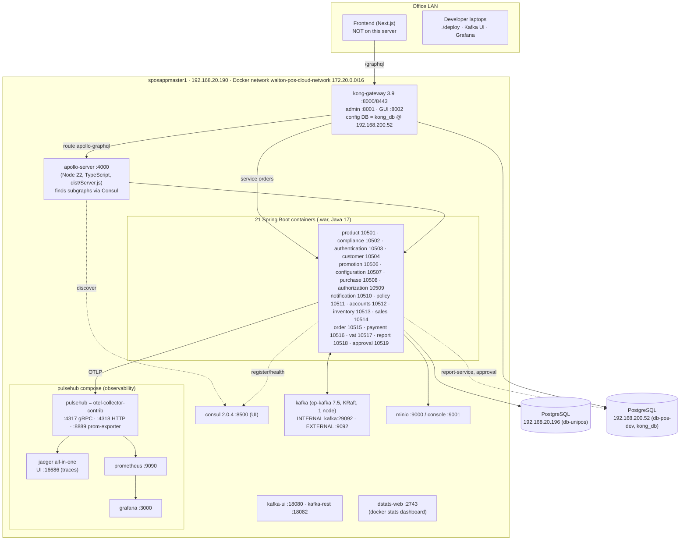
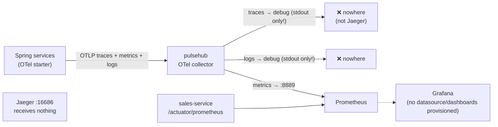

# 08 — Servers (what really runs)

> Sources: `script output/dev server output.txt` and `script output/dev server output  followup.txt` (inventory run 2026-10-17 on the dev server). Demo server (.197): not yet inventoried.

## Dev server `sposappmaster1` (192.168.20.190)
- VMware VM, Ubuntu 24.04.3, kernel 6.8, **8 vCPU, 49 GB RAM** (27 GB used), uptime 319 days.
- Disks: `/` 56 GB (66 %), **`/mnt/workspace` 270 GB** (30 %) — Docker's data-root lives here (`/mnt/workspace/docker`).
- Docker 29.1.2. Host services: PostgreSQL 16 (**localhost only**, 127.0.0.1:5432), ClamAV, chrony.
- **No docker-compose for the app** — each service container is created by its own Terraform (`/mnt/workspace/<svc>-service/IaC`). Only the observability stack (`/mnt/workspace/pulsehub/docker-compose.yml`) is compose-managed. Kafka, MinIO, Consul, Kong, Apollo were started separately (folders `message-broker/`, `object-storage/`, `service-registry/`, `api-gateway/`, `apollo-server/`).

## Full topology (dev)

## What the inventory answered
| Earlier question | Answer from server |
|---|---|
| What is `pulsehub`? | An **OpenTelemetry Collector (contrib)** container. Part of a compose project "pulsehub" with **Jaeger** (traces UI `:16686`), **Prometheus** (`:9090`) and **Grafana** (`:3000`). Collector likely sends traces → Jaeger and exposes metrics on `:8889` for Prometheus to scrape. |
| Elasticsearch / log shipping? | **None on the dev server.** Logs = Docker `json-file` driver, no rotation options set → read with `docker logs <name>`. |
| Which gateway really runs? | `apollo-server`: a **different, newer gateway than `gateway-service/` in your folder** — Node 22 TypeScript (`dist/Server.js`), discovers subgraphs **via Consul** (`SERVICE_DISCOVERY=consul`), knows a `JWT_HEADER`, correlation-id, OTel. Source is on the server in `/mnt/workspace/apollo-server` (+ `api-gateway`). **Need this source code.** |
| Is there Kong? | **Yes, Kong Gateway 3.9 is the real front door.** Route `apollo-graphql`: `/graphql` (GET/POST/OPTIONS) → `apollo-server:4000`. Second service `orders` → `orders-service:10515`. Kong stores its config in Postgres `kong_db` @ 192.168.200.52. |
| Kafka address `172.20.10.108` | = the `kafka` container's fixed IP on `walton-pos-cloud-network`. Also on `kafka-internal-network` (172.30.10.10). KRaft mode (no Zookeeper), single node, **auto-create topics ON**, replication factor 1, PLAINTEXT. So the `172.10.10.108` in payment/promotion config is definitely a typo. |
| notification / price services? | `notification-service` (10510) and **`compliance-service` (10502)** and **`order-service` (10515)** run on the server but **are not in your local folder**. `price-service`, `caching-service` folders exist but aren't running. |

## Surprises / risks found
1. **Almost every service is `(unhealthy)`** (only authentication healthy). Docker healthcheck = `curl -f …/actuator/health`; either curl is missing in the image or health is DOWN (e.g. Kafka/Mongo/mail indicator failing). Containers keep running because Docker doesn't restart unhealthy containers. → follow-up script checks this.
2. **Mixed databases:** `report-service` runs with `db-pos-dev` (192.168.200.52), `approval-service` has **no profile env at all** → falls back to file defaults `local` + `db-pos-dev`. Everyone else uses `db-unipos` (192.168.20.196). So report & approval read a *different* DB server than the rest. **Update (user):** `.196` is the **demo DB** and `.200.52` the **dev DB** → the dev app server mostly writes to the demo DB; only report & approval use the dev DB (Q19).
3. **Kong Admin API (:8001) and GUI (:8002) are open on the LAN without auth** → anyone on the network can change routing.
4. Every infra UI is open on the LAN: Consul `:8500`, Kafka UI `:18080`, Grafana `:3000`, Jaeger `:16686`, Prometheus `:9090`, MinIO `:9001`, dstats `:2743`.
5. Images use `:latest` (consul, minio, otel, jaeger, prometheus, grafana) → not reproducible.
6. Docker logs have no size limit → can fill `/mnt/workspace` over time.
7. Observability containers have `restart=no` → after a server reboot, monitoring won't come back automatically.
8. ~27 old exited containers left over (4 months).
9. All files in `/mnt/workspace` mostly owned by one developer account, world-writable (`drwxrwxrwx`).

## (old) Still unknown → `server-followup.sh` — now answered below
compose/config file contents (the first script's `find` didn't descend into `/mnt/workspace` because it's a separate mount); apollo-server code/config; Kong plugins (is JWT checked there?); real Kafka topic & consumer-group list + lag; why unhealthy; what compliance/notification/order do; log sizes; frontend host.

---

# Follow-up findings (2026-10-17)

## How the infra is built: Terraform per component, one compose
| Folder in `/mnt/workspace` | Tool | Creates |
|---|---|---|
| `docker-network/` | Terraform | network `walton-pos-cloud-network` (172.20.0.0/16) |
| `message-broker/` | Terraform | `kafka-internal-network`, Kafka (KRaft), kafka-ui, kafka-rest |
| `object-storage/` | Terraform | MinIO + `minio-net` |
| `service-registry/` | Terraform | Consul (config in `consul-config/server.json`, `acl.json`; `generate-consul.sh`) |
| `caching-service/` | Terraform | **Redis 7** (172.20.10.102:6379) + redis-commander (:9091). **Defined but NOT running** (only the `redis_data` volume is left) |
| `api-gateway/` | Terraform + scripts | Kong. Well-organised repo layout: `gateway-config/{declarative,plugins,custom-plugins}`, `security/{jwt,acl,secrets}`, `ci/*.yml`, `runtime/{docker,k8s}`, Grafana dashboards. **But see Kong below** |
| `apollo-server/` | Dockerfile + Terraform/K8s | the TypeScript gateway (source code is here: `app/src`) |
| `pulsehub/` | **docker-compose** (+ an unused Terraform variant) | OTel collector, Jaeger, Prometheus, Grafana |
| `<svc>-service/IaC/` | Terraform | each Spring service (same pattern as in your repos) |
| `price-service/`, `apollo-server-old/` | Terraform | old, not running |

So **answer to Q3:** everything is Terraform with the docker provider, run by hand on the server, one folder (and one local `terraform.tfstate`) per component. No central compose/IaC repo seen yet.

## The real Apollo gateway (`apollo-server`)
- Node 22 + TypeScript, **Apollo Gateway 2 / Apollo Server 5 / Express 5** (modern), winston logging, OTel SDK, multer (file **upload routes** `routes/UploadRoutes.js`).
- Pluggable discovery: `ConsulServiceRegistry` (used), `KubernetesServiceRegistry`, `StaticServiceRegistry`.
- How it builds the API (from its logs):
  1. asks Consul for all services → keeps **healthy GraphQL** ones (skips `consul`) → 18 services found
  2. downloads each service's schema (SDL) from `http://<container-ip>:<port>/graphql/`
  3. "federation dependency filtering" → composes **one supergraph from 18 subgraphs**, caches it, refreshes every 30 s (`INTROSPECTION_POLL_INTERVAL`).
  ⇒ A service that is down/unregistered just disappears from the API instead of breaking the gateway.
- `datasource/AuthenticatedDataSource.js` forwards the `authorization` header (`JWT_HEADER`) plus `x-correlation-id` and `traceparent` to every service. It **forwards** the token; there's no sign it **verifies** it **[confirm by reading app/src]**.
- `NODE_ENV=development`, CORS only allows `localhost:3000/4200`. OTel endpoint `http://localhost:4318` — inside a container "localhost" is the container itself → **gateway traces go nowhere**.

## Kong: installed but doing nothing special
- `GET /plugins` → **empty**. No JWT, ACL, rate-limit, CORS or logging plugin is active, even though `api-gateway/security/jwt` exists.
- So it's a plain reverse proxy: `/graphql` → `apollo-server:4000`.
- **Answer to Q6:** as of today **nothing verifies the JWT on the server side** — not Kong, (probably) not the gateway, not the services (`/graphql` is `permitAll`). Only the frontend checks the login session.

## Observability: what really works

- **Traces: broken.** The collector config only has `debug` exporters for traces and logs; there's **no exporter to Jaeger**. So Jaeger's UI is empty; traces are just printed into `docker logs pulsehub`.
- **Metrics: partly working.** Prometheus scrapes the collector (`pulsehub:8889`) and **only `sales-service`** directly. Grafana has no provisioned datasource/dashboards (unless someone set them up by hand in the UI).
- **Logs:** only `docker logs <container>`. No Elasticsearch/Loki. **Docker has no log size limit** (`/etc/docker/daemon.json` sets only `data-root` and DNS).
- To fix it would take about two lines: add an `otlp` exporter → `jaeger:4317` in the traces pipeline.

## Why every service shows "unhealthy"
Docker's healthcheck `curl -f http://localhost:<port>/actuator/health` gets **HTTP 401/403** — Spring Security blocks the health URL in most services (the SecurityConfig permits `/actuator/health` but the request still gets rejected; probably filter order or a trailing path). curl **is** installed.
**Consul still shows them healthy** because services use Consul **heartbeat/TTL** (`heartbeat.enabled=true`), not an HTTP check. That's why the gateway still finds them. ⇒ The "unhealthy" label is cosmetic today, but it means Docker health can't be trusted.

## Kafka: real topics vs consumers
- **22 topics** exist and match the code catalogue in `01-infrastructure.md` §8 (auto-created).
- **Consumer groups present:** approval, report, purchase, account, policy, inventory, authz, customer.
- **Missing:** `promotion-service-group` → **promotion never consumed anything** (confirms the `172.10.10.108` Kafka typo). Payment has no consumer (it only produces).
- `sales-service` and `customer-service` share `customer-service-group` (the copy-paste bug).
- **`authz-group` has lag 9 on `user-areas-topic` and `user-roles-topic` and no active consumer** → (corrected in 02: current authorization code has **no** Kafka listener at all; the group is left from an older version) New role or area assignments made in authentication may **not reach authorization**. Worth reporting to the team.
- Other groups: lag 0 (healthy).

## Extra services
- `notification-service` — Spring, started OK (Sep 30). Consumes `notification-events` (from approval).
- `compliance-service` — Spring, its logs are full of **OTel exporter retry errors** (can't reach its OTLP endpoint).
- `order-service` (10515) — running, Kong has an `orders` route to it; no recent logs.
- None of the three are in your local folder → **still need their repos (Q10)**.

## Not answered
- Postgres databases on the host (needs a password — fine to skip).
- Frontend: not on this server (port 3000 is Grafana) → **Q11 still open**.
