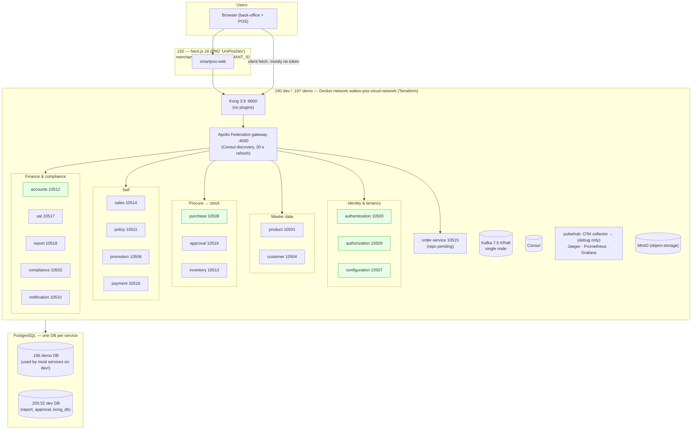
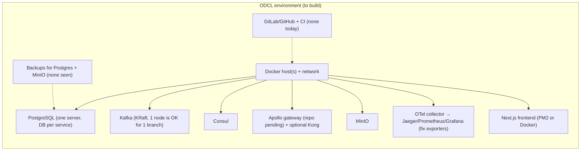

# 09 — Wrap-up: the whole system, and what ODCL must keep / change / remove / build

> Status: **v2**, 2026-10-17 — updated after session E (PaiPai POS, see `10-expotech-current.md`).
> Sources: notes 01–08, plus a quick look at `compliance-service` and `notification-service` (`origin/dev`).

---

## 1. The whole system on one page

Green = verifies the JWT. All others accept anonymous calls.

## 2. Event map (Kafka), with health

| Topic | From → To | Status |
|---|---|---|
| `approval-request-create-events` | purchase, customer → approval | ✅ |
| `approval-events`, `approvalRequest-events` | approval → purchase, customer | ✅ (but sales also uses group `customer-service-group` and competes for messages) |
| `purchase-events` | purchase (DO receive), approval → inventory, purchase | ✅ inventory stock-in. _Corrected 2026-10-18: the approval and promotion listeners are commented out in code._ |
| `purchase-order-events` | approval → purchase | ✅ |
| `account-events` | purchase → accounts | ✅ purchase journal |
| `invoice-report-snapshot`, `mushak-sales-summary-report` | sales → report | ✅ |
| `item-ledger-entry` | inventory → report | ✅ |
| `gl-entry`, `voucher-snapshot`, `chart-of-account` | accounts → report | ✅ |
| `customer-events` | customer → (approval/customer listeners commented out) | ⚪ unused |
| `sales-invoice-created` | only the unused old sales path → promotion | ❌ dead |
| `notification-events` | approval → **nobody** (notification-service has no listener) | ❌ |
| `user-roles/areas/deleted-topic` | authentication → nobody | ❌ |
| `inventory-events`, `bank-deposit-events`, `account-events-sales` | → nobody | ❌ |

Synchronous GraphQL calls do most of the real work in a sale (session 5): sales → customer, accounts ×3, payment, inventory, vat.

## 3. The 15 most important findings (all sessions)

| # | Finding | Session | Severity |
|---|---|---|---|
| 1 | Only 4 of 18 services check the JWT. Kong/gateway don't. 202/204 frontend fetch files send no token. | 2, 7 | 🔴 security |
| 2 | Sales trusts **price, discount, VAT from the browser** | 5 | 🔴 integrity |
| 3 | Any user can read another merchant's data (`merchantScope` takes the requested id) | 2 | 🔴 for multi-company |
| 4 | **Sales journal: Dr Cash / Cr Sales only** — no VAT payable, no COGS, all methods = cash | 6 | 🔴 accounting (ODCL uses only this system) |
| 5 | A sale calls 7 services in a row with **no compensation** on failure | 5 | 🟠 data consistency |
| 6 | Stock: one row per physical unit (serial). No quantity-based selling. No BOM. | 3, 4 | 🟠 blocker for restaurant |
| 7 | Payment hard-coded to cash. No split payment. No till/shift sessions (ERD only). | 5 | 🟠 must-have for Expotech |
| 8 | Policy and promotion engines exist but **are not called** by sales | 5 | 🟡 |
| 9 | Returns don't put stock back or refund | 5 | 🟡 |
| 10 | Schema by `ddl-auto=update`, no migrations. Money as `Double` in places. | 1, 5 | 🟠 maintainability |
| 11 | Config bugs: purchase→approval port 10505, sales→order port 10508, Kafka IP typo, shared consumer groups | 1, 4, 5 | 🟡 easy fixes |
| 12 | Dev server mixes DBs (dev app → demo DB) | 8 | 🟡 |
| 13 | Observability: traces go nowhere, logs unbounded, `:latest` images, open admin UIs | 1, 8 | 🟡 ops |
| 14 | No tests (backend tests commented out, frontend none) | 4, 7 | 🟠 |
| 15 | Frontend merchant fixed by env, super admin by env | 7 | 🟢 convenient for ODCL now |

## 4. ⭐ ODCL plan per service: keep / change / remove / build

Legend: **K** keep as is · **C** change · **R** remove/hide · **B** build new.

| Service | Verdict | What |
|---|---|---|
| authentication | K + C | keep login/JWT. **New RSA keys.** Drop HRMS sync + Kong/ngrok code. Use refresh tokens. Put merchant (and admin flag) in token. |
| authorization | K | roles/permissions/menus as is. Create ODCL roles. Hide Walton menus. |
| configuration | K + C | ODCL merchant + 4 BINs exist. **Create Expotech business-area tree** (probably 1 sales hub). Fix merchant scope. Keep `ebs_customer_id` empty. |
| product | K + **B** | keep catalogue + prices + declared price. **Build: BOM (recipe header + lines), UoM conversion, item kind (serial / quantity / made-to-order), kg/g/L/ml units.** Ignore EBS fields. |
| customer | K (light) | person + phone, optional. Allow walk-in. Most CRM/dealer/survey features unused. |
| purchase | K | PR → PO → DO with approval, local suppliers. Make DO receive work by quantity (no sequential fake serials) + expiry date. Fix approval URL. |
| approval | K | one-stage path for Expotech's manager. |
| inventory | **C + B** | **Build quantity-based stock path** (stock summary only, FIFO/expiry), **ingredient deduction from BOM on sale**, **daily stock count / adjustment**, wastage. Fix ledger (cost not MRP). Consumable stock tables may serve as ingredient stock. |
| sales | **C + B** | Retail engine only. Price from server. Quantity lines. Walk-in customer. One customer account per customer. Proper payment details. Returns with stock-back/refund. Compensation or saga. **Build: hold/recall bill, table/KOT (if Q26 says yes).** Remove Hire/EMI/Dealer engines (or leave unused). |
| policy | C | wire `evaluateForSalesType` into the sale. Configure **Expotech's own policy** (Q21). |
| promotion | C | fix Kafka config. Wire loyalty / discount rules into the sale if wanted (Q28). |
| payment | **B** | use split payments (cash, card, bKash, Nagad). **Build cash sessions (open/close till, handover), Z-report.** |
| accounts | **C** | **Fix sales GL** (VAT payable, COGS, per payment method). Seed ODCL COA. Keep vouchers, expenses, bank, assets, periods. Remove Hire/EMI parts. |
| vat | C | configure restaurant VAT rate (Q30). Check registers for BOM-based business. |
| report | K + B | keep Jasper reports. Add daily sales, item-wise, Z-report, stock count, recipe cost. |
| compliance | ? | branch audit checklists (assessment templates/sections/items, evidence in MinIO, approvals) + system audit/error logs. Probably not needed for one branch. Decide. |
| notification | ? | email/SMS/in-app templates + queue (Gmail SMTP). **No Kafka listener yet.** Useful later (low-stock, approval alerts). |
| order-service | ? | repo pending (Q29). |
| frontend | K + **B** | reuse back-office. **Build touch POS screen + thermal receipt + kitchen ticket printing.** Central fetch helper with token. Set `TEMP_MERCHANT_ID` = ODCL. |

## 5. Walton-specific things to strip or replace
- **Oracle EBS links:** `ebs_inventory_item_id`, `ebs_item_code`, `operating_unit_id`, `enterprice_sku_id`, `enterprice_price_list_line_id` (product); `ebs_customer_id` (configuration, purchase DO); supplier operating units modelled on Walton Hi-Tech.
- **Walton HRMS** sync (authentication), `hrms.waltonbd.com` images (frontend).
- **Walton merchants** seed (WDN, WHAP, WPLZ, WES, CSD) in `MerchantDataInitializer`.
- **Hire, EMI, Dealer, Corporate, surokkha cards, CSD party, plaza management, sales-hub targets/incentives**: not for Expotech.
- **Walton Plaza policy v6** rules (if seeded).
- **Infra identity:** GitLab `gitlab.waltonbd.com/pos/*`, server IPs 192.168.20.x / 192.168.200.52, MinIO at .191, Gmail SMTP account, RSA key pair, Jasypt key, DB passwords. **All must be new for ODCL.**
- Grade A–E pricing (electronics refurb grades): use grade A only.

## 6. Infrastructure ODCL must stand up

Needed from your manager: **apollo-server gateway, Kong/api-gateway, order-service, Terraform folders** (`message-broker`, `object-storage`, `service-registry`, `docker-network`, `pulsehub`, `caching-service`).

Consider simplifying for one branch: 18 services + Kafka + Consul + Kong is a lot to run for one restaurant. Options (decide later):
1. **Run as is** (least code change, most ops work).
2. **Trim**: drop Kong, compliance, notification, promotion (if unused). Keep the rest.
3. Longer term: merge services into fewer deployables.

## 7. Suggested order of work (until and after January 2027)

| Phase | When | What |
|---|---|---|
| 0. Prepare | now → Dec 2026 | Collect missing repos (gateway, Kong, order, Terraform). Get Expotech's Grails code + answers. Decide data strategy (clean start vs migrate). Set up ODCL git + CI. |
| 1. Stand up | Jan 2027 | ODCL infra, new secrets/keys, seed ODCL merchant, BINs, business area, COA, roles, users. Fix config bugs. Turn on JWT checking everywhere + token in frontend. |
| 2. Sell basics | Q1 2027 | Quantity-based stock + selling, server-side price, walk-in customer, split payment, cash sessions, receipt printing, sales GL fix. |
| 3. Restaurant | Q1–Q2 2027 | BOM + UoM conversion + ingredient deduction, daily stock count, expiry FIFO, wastage, touch POS, KOT/table (if needed). |
| 4. Rules & polish | Q2 2027 | Wire policy engine with Expotech policy, loyalty, returns with refund, reports (Z, item-wise, recipe cost), restaurant VAT. |
| Ongoing | — | Flyway migrations, tests, monitoring, backups. |

## 8. Open decisions (for you / ODCL management)
1. **Data strategy:** clean start vs migrate ODCL rows (not decided). Note: persons have no `merchant_id`, and the COA is shared, so a migration needs care.
2. Keep the 18-service architecture or trim it (section 6).
3. Counter-only or table service (Q26) → decides KOT/table work.
4. Who will host ODCL's servers (on-prem in Bogura? cloud?) given offline isn't required (Q33).
5. Fork from which commit/branch of Walton's repos (`dev` as of a date in Dec 2026?).

---

## 9. Update after reading PaiPai POS (Expotech's current system)

**PaiPai already does what UniPOS is missing for Expotech:** recipes with wastage and addition costs, nested recipes, **auto-production at the moment of sale** (consume raw materials FIFO by lot, weighted-average cost), set menus, quantity stock with expiry lots, a complete sales journal (sales, VAT, cash/receivable, COGS, inventory), table assignment, an online-order API for Expotech's website, and the full Mushak report set including 4.3 with BOM.

What changes in the plan:
1. **Source of business rules = PaiPai.** Port `RetailSalesService.autoProduce`, `ProductBoM*`, `SetMenu*`, `StockItemLot`, and `SalesInvoiceToRelatedEntitiesCreatorMgrService` (GL rules) into UniPOS product / inventory / sales / accounts.
2. **Data migration = PaiPai Oracle → UniPOS PostgreSQL** (items, BOMs, customers, suppliers, opening stock with lots, COA, open balances). Not Walton UniPOS rows. This mostly settles the "data strategy" question: ODCL's history lives in PaiPai, not in Walton's UniPOS.
3. **Keep the website integration:** UniPOS must offer an equivalent of `/api/expotech/onlineOrder/save` and `/customer/save`, or the website must be changed.
4. **Scope may be wider than a restaurant:** PaiPai has coffee, restaurant, convention, eyewear, eye-care, dental and pharmacy flags (Q35).
5. **Rotate PaiPai DB passwords** (13 config files with passwords committed to git).
6. Phase 3 ("Restaurant") gets shorter, because the logic is proven and only needs porting, not inventing.

Revised top of the build list: BOM + auto-production (port) · quantity/lot stock (port) · sales GL (port rules) · split payment (UniPOS model) · online-order API (port) · touch POS + printing (new) · cash sessions (new, neither system has it).

## 10. Scope update (2026-10-18)
- **All Expotech business lines are live:** coffee, restaurant, convention, eyewear/optical, eye-care, dental, pharmacy (Q35). UniPOS has **none** of the clinic / optical / pharmacy features (prescriptions, doctors, lenses, medical services, drug batches/expiry); PaiPai has them.
- ⇒ The plan "port PaiPai's rules into UniPOS" now includes those industries, which is much larger work. **Open decision for ODCL management:** (a) UniPOS for everything, (b) UniPOS for retail/F&B and PaiPai kept for clinics/optical/pharmacy for a while, or (c) phase it: F&B + packaged retail first, others later.
- Debobrato (PaiPai developer) joins ODCL (Q37): the key person for porting PaiPai rules and for the data migration.
