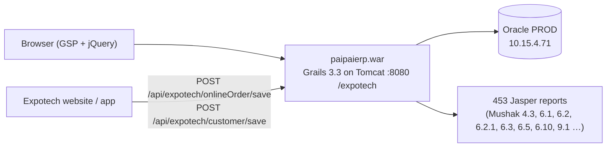

# 10 — Expotech's current system: PaiPai POS (`paipaierp`)

> Status: **first read**, 2026-10-17. Read-only. Config files with DB passwords were **not** opened.
> Repo: `/home/mahathir/Downloads/projects/paipaierp`, GitLab `10.15.4.73` / `10.15.4.84:2222` → `ict/pai-pai-pos/paipaierp`.
> Local copy = `main` (2026-07-13, same as `paipai-production`). Newest work is on **`Debobrato_Dev` (2026-10-13)**; also `paipai_develop` / `paipai-other-pos` (2026-08-22).
> Practically one developer: **Debobrato Biswas** (122 + 18 commits as `DEBO-ODCL`).

## 1. What it is

| | PaiPai POS |
|---|---|
| Type | **One monolith**: Grails **3.3.1** (2017) · GORM 6.1 / Hibernate 5.1 · Groovy · GSP + jQuery pages · Spring Security · Jasper |
| Database | **Oracle** (`jdbc:oracle:thin:@10.15.4.71:1521:PROD`) |
| URL | `http://<host>:8080/expotech` |
| Size | 208 domain classes · 404 services · 81 controllers · 80 GSP views · **453 Jasper report templates** |
| Origin | A generic multi-client ERP product ("**werp**"): config files for *dining*, *majisto*, *smart_pos*, *pipi_pos*, *paipai live/test*. Also contains `customize/walton/*` and `ebsdopull` (Walton EBS DO pull). So it's a sibling of Walton's older ERP. |
| UI | Metadata-driven generic screens (`genUi`, `systemApi/processClientRequest?rEntityName=…`) rather than one page per feature |
| Industries built in | trading, **manufacturing (BOM)**, **restaurant / coffee / convention**, **optical / eye-care / dental / pharmacy** (prescriptions, doctors, lenses) |



## 2. Modules (domain packages)

| Package | Classes | Highlights |
|---|---|---|
| base | 63 | Organization → OperatingUnit, Item (+ type, category, sub-category, group, model, brand, UoM, lot, serial), Customer, Supplier, **POSCounter**, **TableAssign** (table no., waiter), PaymentMethod, SalesPromotion / ItemPromotion / GroupPromotion, CombinedItem, Packages, Doctor, ClinicalMaster, MedicalService, Lensline |
| production | 9 | **ProductBoM** + components + addition costs, **SetMenu** + components + addition costs, **MaterialConsume** (+details), PurchaseAndIssueLedger |
| sales | 17 | SalesOrder (+lines), **SalesOrderOnline** (+details), SalesInvoice (+lines, serials), SalesReturnDoc, installment scheme/collection, SalesBook, prescriptions |
| inventory | 14 | Store, StockMaster (qty + **weighted average cost**), StockItemLot (**expiry**, lot cost), StockItemSerial, StockTransaction (+templates), StockItemLedger, ItemReceive (production receive), TransferOrder |
| purchase | 11 | Requisition → PO → GRN (+serials) → Purchase invoice, purchase return |
| accounts | 18 | COA, voucher master/detail, **AccGeneralLedger**, income-statement ledger, periods, financial year, cost centre, bank/branch/account, money receipts, customer receive, supplier payment, fixed-asset register |
| vat | 7 | **Mushak_6_1, 6_2, 6_5, 9_1 (+ledger)**, VAT notes |
| approval | 6 | approval process → groups → members → stage status path |
| system / auth | 25 | menus, menu/report/process authorization, users, login history, installed modules, counters, UI layout customisation |
| integration | 7 | import items, opening stock, BOMs, sales invoices |

## 3. ⭐ How a restaurant sale works today (the part UniPOS lacks)

```mermaid
sequenceDiagram
    participant C as Cashier (counter)
    participant S as RetailSalesService
    participant ST as Stock (StockMaster / lots)
    participant GL as AccGeneralLedger
    participant V as Mushak 6.2 / 9.1
    C->>S: invoice lines (item, qty, price, discount, VAT/SD), payment split
    S->>S: validateStock (serial items → serial; item-controlled → StockMaster qty;<br/>made-to-order items type 2/3 skip the check)
    S->>S: AutoProduction (item is finished good with active BOM):
    loop each BOM component (recursive for nested recipes, cycle check)
        S->>ST: check RM stock ≥ component qty × sold qty
        S->>ST: ISSUE RM (lot-wise FIFO if lot-controlled) at weighted avg cost
    end
    S->>ST: RECEIVE finished good (cost = RM cost) → ItemReceive doc "RETAIL_SALES"
    S->>ST: ISSUE finished good for the sale
    S->>GL: Dr Cash/Receivable · Cr Sales · Cr VAT current · Dr COGS · Cr Inventory
    S->>GL: Auto-production GL: Dr Production cost (COA id 353) / Cr RM inventory (COA id 93)
    S->>V: sales register / VAT ledger
```

- **Recipe (BOM) component**: item, qty (**including wastage**), UoM, unit price, wastage type/%/amount, `produced` flag (make it vs buy it). Plus **addition costs** (direct/indirect: gas, labour…) → feeds **Mushak 4.3** price declaration with raw-material and addition-cost sub-reports.
- **Nested recipes**: a component that is itself a finished good (e.g. a sauce) is produced first, recursively.
- **Set menu** = a combo built from other items (same structure as BOM).
- Production cost for an item with no stock history falls back to `flatPrice`, then the BOM total.

## 4. Sales, payment, customer

- **SalesInvoice**: counter code, customer (+ name/phone typed in), sales person, store, discount, rebate, SD + VAT, **total COGS**, cash received, due, adjustment %, shipping, EMI/installments, **NBR send flags** (`sendToNbr`, batch no/date), Mushak print count.
- **Split payment exists**, but as **one column per method/bank**: `paymentInCash`, `paymentInCITY`, `paymentInEBL`, `paymentInBBL`, `paymentInDBBL`, `paymentInBKASH`, `paymentInNAGAD`, `paymentInBank`, `paymentInMobileBank`, … plus tracking numbers per bank. Adding a new bank means a schema change.
- **Customer** flags: `isCoffee`, `isRestaurent`, `isConvention`, `isEyeWare`, `isEyeCare`, `isDental`, `isPharma` → **Expotech has several business lines** (Q35). Some lines trigger a **QR** on the receipt.
- **Online orders**: `SalesOrderOnline` from Expotech's website/app (`/api/expotech/onlineOrder/save`, payment method/ref, gateway charge rate, shipping/billing address) → staff convert to invoice. API hard-codes **organization 701 / operating unit 2750**.
- **Table service**: `TableAssign` (table no., waiter, assigned/released). `SalesOrder` exists as a pre-invoice order.
- **Promotions**: item/group/sales promotions (% or amount, gift item, minimum purchase, date range).
- **No shift/day-close found** (POSCounter has opening/closing *dates*, not cash sessions).

## 5. VAT
- Organization has `vatPolicy` **SDF-6.1 vs SDF-6.2** and `businessNature` **TRADING vs MANUFACTURING** (`manufacturingModeRun`, `tradeModeRun`).
- Reports: **Mushak 4.3** (price declaration with BOM), **6.1** (purchase register), **6.2 / 6.2.1** (sales / purchase-sales register), **6.3** (many versions incl. POS/retail), 6.4, **6.5** (transfer), **6.10**, **9.1** (return). Expotech files as a manufacturer/producer (BOM-based 4.3). This partly answers Q30.

## 6. Quality & risks
| Finding | Note |
|---|---|
| Very old stack | Grails 3.3 (2017), Hibernate 5.1, jQuery. Hard to hire for, no security updates. |
| **13 config files with DB passwords committed to git** | Not opened. These must be rotated and moved out of git. |
| Hard-coded IDs | COA ids 93/353 in auto-production GL, org 701 / OU 2750 in the API, item types 2/3 |
| One developer | knowledge concentrated in one person (Debobrato) |
| Debug code | `println` everywhere, Bangla comments |
| Schema | `database-migration` plugin + manual SQL files (`alter query.txt`, `auto_production_gl_posting.sql`) |
| Payment model | one column per bank |
| No tests | — |

## 7. ⭐ PaiPai vs UniPOS — feature by feature

| Feature | PaiPai today | UniPOS | ODCL action |
|---|---|---|---|
| Recipe / BOM, wastage %, addition cost | ✅ full, nested | ❌ | **port to UniPOS** (product + inventory) |
| Auto-production on sale (consume RM, FIFO lots) | ✅ | ❌ | **port** (inventory, on invoice commit) |
| Set menu / combo | ✅ | ❌ | port |
| Quantity-based stock + weighted avg cost | ✅ StockMaster | serial only (+ consumables) | build |
| Expiry lots | ✅ StockItemLot | `expiry_date` per instance only | build |
| Split payment | ✅ (column per bank) | model yes, unused | wire `payment_details` (better design) |
| Sales GL with VAT + COGS | ✅ | ❌ Dr Cash/Cr Sales only | **fix UniPOS** using PaiPai's rules as reference |
| Table assignment / waiter | ✅ basic | ❌ | build if Q26 = table service |
| Online orders API (website) | ✅ | ❌ (order-service?) | **must keep** → Q36 |
| Mushak 4.3 with BOM | ✅ | 4.3 without BOM | extend |
| Mushak 6.1/6.2/6.2.1/6.5/6.10/9.1 | ✅ reports | vat-service has registers + 9.1 | compare outputs line by line |
| Optical / dental / eye-care / pharmacy (prescriptions) | ✅ | ❌ | **decide** → Q35 |
| Installment / EMI | ✅ | ✅ | probably unused |
| Shift / till close | ❌ | ❌ (ERD only) | build |
| Approvals | ✅ simple | ✅ richer | UniPOS |
| Microservices, GraphQL, Bangla UI, modern stack | ❌ | ✅ | UniPOS |

**Bottom line:** PaiPai already has the restaurant logic UniPOS is missing (recipes, auto-production, lots, proper sales journal). UniPOS has the modern architecture. The ODCL work is mostly **porting PaiPai's business rules into UniPOS**, and the data migration will be **from PaiPai's Oracle DB**, not from Walton's UniPOS.

## 8. Confirmed: target database is PostgreSQL (user, 2026-10-17)
When UniPOS replaces PaiPai at ODCL, the database will be **PostgreSQL** (same as UniPOS today), not Oracle. So the cut-over is a **cross-database migration: PaiPai Oracle → UniPOS PostgreSQL** (one DB per service).

Things to plan for:
| Topic | Oracle (PaiPai) | PostgreSQL (UniPOS) | Note |
|---|---|---|---|
| Keys | `Long id` with `increment` generator / sequences | UUID (v7) or Integer per service | keep a **mapping table old id → new id** per entity |
| Numbers | `NUMBER`, `Double`/`Float` in domain | `numeric` / BigDecimal | round money to 2 dp during load |
| Dates | `DATE` (has time) | `date` vs `timestamp` | decide per field |
| Text | Bangla text (VARCHAR2, check NLS charset) | UTF-8 | verify charset to avoid broken Bangla |
| Booleans | `'1'/'0'` strings, `Boolean` | `boolean` | e.g. `isPayment == '1'` |
| Logic in DB | PL/SQL scripts (`auto_production_gl_posting.sql`), `*_orcl` Jasper reports | — | not migrated; logic is re-implemented in UniPOS services |
| One schema | ~200 tables in one schema | split across ~15 service databases | each PaiPai table must be assigned to its owning service |

What to migrate (proposal): masters (items, UoM, categories, BOMs/set menus, customers, suppliers, COA), **opening stock by lot with cost**, open customer/supplier balances, and GL opening balances at the cut-over date. Keep history (old invoices, Mushak registers) **read-only in PaiPai/Oracle or an archive** rather than converting it. Decide with ODCL management and the VAT consultant.

Tooling options: a one-off ETL (e.g. Python or Java reading Oracle via JDBC and calling UniPOS GraphQL mutations or writing SQL), or a staging Postgres + SQL scripts. Prefer going through the services' own rules where possible.
