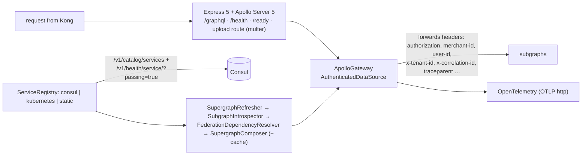
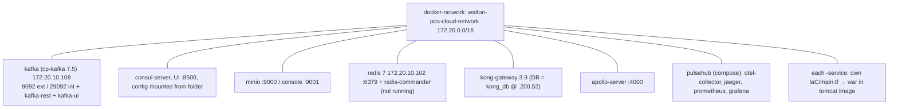

# 11 — Infrastructure sources collected from the dev server

> Status: **read**, 2026-10-18. Source: `script output/unipos-collect-2026-10-18.tar.gz`, unpacked into **`/home/mahathir/Downloads/projects/walton-infra-copy/`**, outside the study notes.
> ⚠ **Keep that folder private.** It still contains a few files with secrets that my exclude list missed: `api-gateway/runtime/docker/env/{dev,prod}.env` (4 secret lines each), `api-gateway/.../dev/terraform.tfvars` (Kong DB password), `object-storage/terraform.tfvars` (MinIO password), plus Consul's runtime data (`service-registry/consul-data/`). They weren't opened or printed. ODCL must create new values for all of them anyway.

## 1. What we got

| Folder | Git repo? | What it is | Complete? |
|---|---|---|---|
| `apollo-server/` | **no** (copy only, no history) | TypeScript gateway source (`app/src`, 31 files, ~3 000 lines), Dockerfile, Terraform for **dev / qa / uat / prod** | ✅ buildable |
| `api-gateway/` | no | Kong 3.9: Terraform (dev, prod, modules), declarative YAML, 2 custom Lua plugins, CI files, k8s manifests, Grafana dashboards, JWT public keys | ⚠ scaffolding, see §3 |
| `message-broker/` | no | Terraform: Kafka 7.5 + Kafka REST + Kafka UI | ✅ |
| `object-storage/` | no | Terraform: MinIO (API 9000, console 9001) | ✅ |
| `service-registry/` | no | Terraform: Consul single server (`-bootstrap-expect=1 -ui`), config, `generate-consul.sh` | ✅ |
| `docker-network/` | no | Terraform: `walton-pos-cloud-network` 172.20.0.0/16 | ✅ |
| `caching-service/` | no | Terraform: Redis 7 + redis-commander (172.20.10.102) | ✅ (not running on dev) |
| `pulsehub/` | no | docker-compose + OTel collector config + Prometheus + Terraform | ✅ |
| `order-service/` | no | **only** Dockerfile + `IaC/main.tf` + compiled **`order-0.0.1.war`** (136 MB) | ❌ **no source code** |

⇒ The infra is fully recoverable. **order-service source is still missing** (only in Walton GitLab).

## 2. Apollo gateway (`apollo-server`) — now confirmed from source

- Config env vars: `PORT, HOST, NODE_ENV, SUPERGRAPH_SDL, INTROSPECTION_POLL_INTERVAL, SERVICE_DISCOVERY, CONSUL_HOST/PORT/DATACENTER, LOG_LEVEL, OTEL_ENABLED/SERVICE_NAME/EXPORTER_OTLP_ENDPOINT, JWT_HEADER, CORRELATION_ID_HEADER, TRACEPARENT_HEADER, CORS_ALLOWED_ORIGINS`.
- **Does not verify JWTs**; it only passes headers on. Confirms session 2.
- Subgraphs that can't compose (missing federation dependencies) are **dropped automatically**, so a broken service silently disappears from the API.
- Discovery also supports **Kubernetes** and **static** lists, which makes it easy to run without Consul (useful for ODCL's smaller setup).
- Minor: the `dev` script points at `src/server.ts`, but the file is `Server.ts` (case-sensitive on Linux).
- No tests ("No tests configured yet").

## 3. Kong (`api-gateway`) — design vs reality

| | In the repo (design) | Live on dev (`kong/*.json`) |
|---|---|---|
| Services | `orders` (Terraform); `orders`, `payments` (declarative examples) | `apollo-gateway`, `orders` |
| Routes | `/orders` | **`/graphql`** → apollo (**not in Terraform**, created by hand) |
| Plugins | **jwt**, rate-limiting, cors on `orders`; request-transformer | **none** |
| Workspaces / consumers | `default`, `merchant-plaza`, `merchant-wes`; consumers `merchant_plaza`, `merchant_wes` | — |
| Custom plugins | `tenant-auth` (multi-tenant JWT), `workspace-guard` | **12-line stubs**, not implemented |
| CI | GitHub-Actions style `deploy.yml` with wrong paths (`infrastructure/terraform/...`) | not used (no CI, Q8) |

⇒ Kong was **planned** as the place for JWT checking and per-merchant isolation, but that was never finished, and the live config drifted from the Terraform. For ODCL: either finish it (JWT plugin on `/graphql` using the public key) or drop Kong and verify JWT in the gateway or services.

## 4. Infrastructure as built (Terraform, docker provider)

- Fixed IPs, published ports, and `:latest` / pinned images mixed. Matches the session 8 findings.
- Terraform state (`*.tfstate`) was **not** copied, so for ODCL every component is a fresh `terraform apply` with new variables.

## 5. order-service (from the compiled `.war`, schema only)
- Package `com.walton.pos.order`. Tables: **Order, OrderedItem (unit type), OrderPayment, OrderShipment, OrderStatusHistory, OrderTax, OrderDiscount, OrderType**, Outbox.
- GraphQL: plain CRUD (`addOrder`, `addOrderedItem`, `addOrderPayment`, `addOrderShipment`…). Status NONE / PENDING / CONFIRMED / CANCELLED / COMPLETED. Payment CASH / CREDIT_CARD / ONLINE. Shipment PENDING → DELIVERED / RETURNED.
- ⇒ A simple **order / e-commerce order** service, used by sales (`OrderGraphQLClient`) and Kong's `/orders`. It could serve as the base for **Expotech's online orders** (PaiPai's `/api/expotech/onlineOrder`) and **table / pre-bill orders**.
- Only compiled; the source is needed from Walton GitLab (Q41). Small enough to rewrite if not available.

## 6. What this means for ODCL
- ✅ Everything needed to **stand up the infrastructure** is now in hand: network, Kafka, Consul, MinIO, Redis, Kong, the gateway, observability.
- ❌ Still missing: **order-service source**.
- To do in the setup guide: new secrets for every `tfvars`/`.env`, rename network/containers (drop "walton"), decide Kong yes/no, pick the gateway discovery mode (Consul vs static).

## 2026-11-03: Apollo gateway from its own repo (`apollo-server`, origin/dev `d17b2e6`)
The repo is now in the projects folder. Atlas level 8 "Apollo gateway" is built from it on every refresh (`atlas-src/extract_apollo.py`, `compose_check.cjs`); Sync moved to level 9.

**Registration.** A service never contacts the gateway. Spring Cloud Consul registers it (name, IP, port, labels). The gateway reads the catalog, asks for each name's passing instances, keeps `deployment=docker` + `environment=dev`, and takes the first one.

**Supergraph.** Every 30 s, and at startup if there is no cache: discover → POST `{ _service { sdl } }` to each service with no token → dependency filter → `composeServices` → save `cache/supergraph.graphql` → swap into the running gateway. A failure at any stage keeps the current supergraph.

**Verified on 2026-11-03**
- Live: all 18 services in Consul, 1,804 root operations on the gateway.
- Composing origin/dev's real schemas with the gateway's own library succeeds. Without accounts, approval, authorization, configuration, customer, product or purchase it fails with EXTENSION_WITH_NO_BASE, so updates stop. Without any of the other 11 (including authentication) it composes and that service's operations vanish.
- This test joins each repo's schema files. It approximates what each service returns from `_service`; it doesn't read them from the running services.

**Findings**
- `customer-service` was usable in Consul at `192.168.222.178`, not a Docker address. The labels are fixed in application.properties, so a run with the local profile looks like a deployed instance. customer-service's committed default profile is `local`; the others are `prod`.
- The discovery filter is fixed to `environment=dev` in the gateway's code. ODCL should make it a setting.
- `FederationDependencyResolver` only sees `extend type`; these schemas use `type X @extends`.
- `authentication-service` has 13 passing entries: HTTP check, same address after each redeploy.
- Dev `terraform.tfvars` line 11 has an unclosed quote on PORT; `container.tf` maps to internal 4042 while PORT is 4000. The running gateway answers on 4000.
- `cors()` with no options runs before the allow-list, so the list has no effect. `context.correlationId` is never set, so the gateway doesn't create ids.
- `/api/upload/:service/:purpose` reads `*_SERVICE_URL` variables the dev Terraform doesn't pass, and the frontend doesn't call it.
- 7 of 31 source files are not reachable from Server.ts, including the Kubernetes registry (empty) and `SubgraphDependencies`.
- The deploy script's gateway restart looks unneeded given the 30 s refresh. To confirm with the manager.
- customer-service commits a stale `bin/` copy of its schemas; the extractors now read `src/` only.
